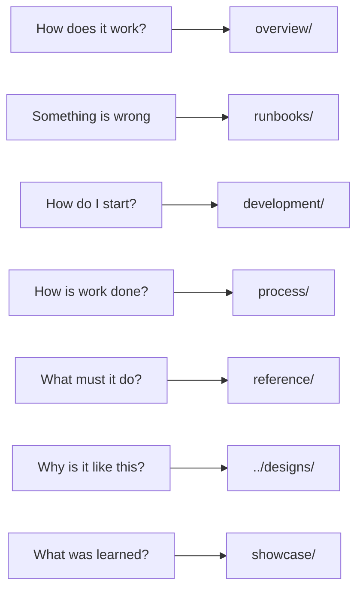

# Documentation map

Every document in the hub, grouped by the question it answers. Each component repository's own README
describes that component; these documents cover what spans them.

## How it works: [overview/](overview/)

| Document | Covers |
|---|---|
| [system.md](overview/system.md) | Every running part, how a request moves through them, who owns what. Start here |
| [repositories.md](overview/repositories.md) | The repositories, how they depend on each other, shared conventions |
| [delivery.md](overview/delivery.md) | Environments, ephemeral environments, the release pipeline, rollback |
| [github.md](overview/github.md) | Issues and pull requests, branch protection, every workflow, secrets, publishing |
| [testing.md](overview/testing.md) | Test layers across the system, use-case tracing, why the layers are shaped as they are |
| [api-contract.md](overview/api-contract.md) | The GraphQL schema, how clients get it, conventions, keeping installed apps working |
| [data.md](overview/data.md) | What is stored, why a day at a time, the booking window, limits, reset and repair |
| [concurrent-updates.md](overview/concurrent-updates.md) | Simultaneous writes, stale edits, live updates, web and Android caches |
| [identity-and-access.md](overview/identity-and-access.md) | Accounts and people, sign-in, tokens, roles, special accounts |
| [security.md](overview/security.md) | The layers of protection, GitHub and AWS trust, personal data, known gaps |
| [aws-accounts.md](overview/aws-accounts.md) | The two accounts, access, guardrails, shared foundations, limits |
| [cost-and-scale-to-zero.md](overview/cost-and-scale-to-zero.md) | What it costs, why it idles at almost nothing, what deletes what |
| [time-and-time-zones.md](overview/time-and-time-zones.md) | The one-office time model, display preferences, whose "today" |
| [performance.md](overview/performance.md) | How fast it is, cold starts, bounds, timeouts |
| [demo-data.md](overview/demo-data.md) | The generated demo and how it is kept topped up |
| [operations.md](overview/operations.md) | What watches the system, logs, scheduled jobs, routine checks |

## When something is wrong: [runbooks/](runbooks/README.md)

Twenty-two runbooks, indexed by symptom with a triage chart.

## Getting started: [development/](development/)

| Document | Covers |
|---|---|
| [getting-started.md](development/getting-started.md) | Clone, set up, sign in, your own environment, run the tests |
| [workstation.md](development/workstation.md) | The workstation manifest and the versioned workspace settings |

## How work is done: [process/](process/README.md)

| Document | Covers |
|---|---|
| [README.md](process/README.md) | The rules for every piece of work |
| [principles.md](process/principles.md) | The constraints everything else follows from: cost, stack, review |
| [branching-and-prs.md](process/branching-and-prs.md) | Branches, commits, pull requests, cross-repository changes |
| [issues-and-board.md](process/issues-and-board.md) | Issues, labels and the project board |
| [ai-collaboration.md](process/ai-collaboration.md) | Working with AI agents: models, AI review, reasoning versus instrumenting |
| [java-code-style.md](process/java-code-style.md) | Java formatting and linting, and why each setting is what it is |

## What it must do: [reference/](reference/)

| Document | Covers |
|---|---|
| [use-cases.md](reference/use-cases.md) | The numbered, testable requirements both apps meet |
| [business-functionality.md](reference/business-functionality.md) | The same rules in plain language |
| [glossary.md](reference/glossary.md) | Terms with a specific meaning here |

The detailed data model (every table, key and attribute) lives with the code, in
[mootmaker-api's docs/data-model.md](https://github.com/geoffweatherall/mootmaker-api/blob/main/docs/data-model.md).

## Why it is like this: [designs/](../designs/README.md)

One design per feature or change, written before the work. Completed designs are
[archived with an index](../designs/archive/README.md) of how relevant each still is.

## What was learned: [showcase/](showcase/)

The write-ups that go with the project as a portfolio piece. These are dated pieces of writing, not
maintained descriptions of the system.

| Document | What |
|---|---|
| [learnings.md](showcase/learnings.md) | What building Mootmaker taught about AI-assisted development |
| [debugging-techniques.md](showcase/debugging-techniques.md) | Debugging techniques, through one real bug hunt |
| [live-updates-talk-short.md](showcase/live-updates-talk-short.md) | Live updates in the web app: the short talk |
| [live-updates-talk.md](showcase/live-updates-talk.md), [live-updates-deep-dive.md](showcase/live-updates-deep-dive.md), [live-updates-open-questions.md](showcase/live-updates-open-questions.md) | The full talk, the deep dive behind it, and answers to its open questions |
| [v2-day-keyed-rewrite-tour.html](showcase/v2-day-keyed-rewrite-tour.html) | A code tour of the v2.0.0 day-keyed rewrite |
| [features-overview.md](showcase/features-overview.md) | The feature list for marketing copy |
| [marketing/](showcase/marketing/) | The marketing brochure (PDF) |
| [branding/](showcase/branding/README.md) | Logo, palette and design tokens |
| [privacy-policy-draft.md](showcase/privacy-policy-draft.md) | A draft privacy policy, not published |

[ideas.md](ideas.md) holds half-formed ideas that are not designs and not commitments.
