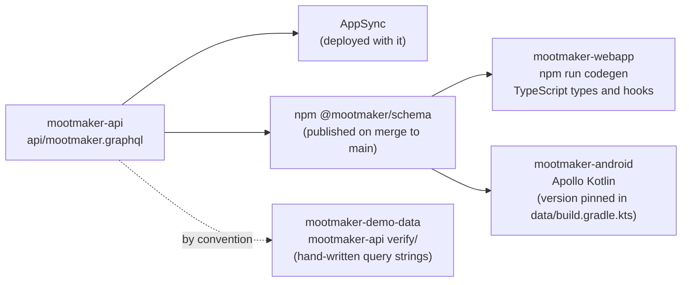
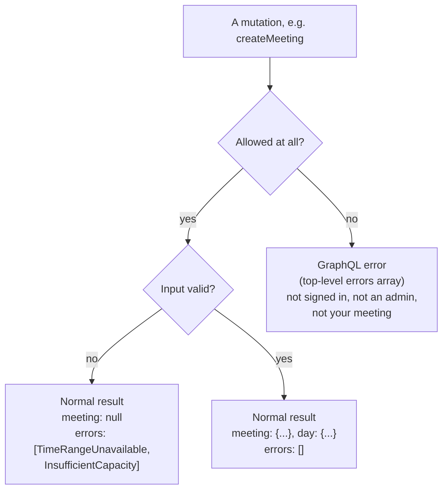
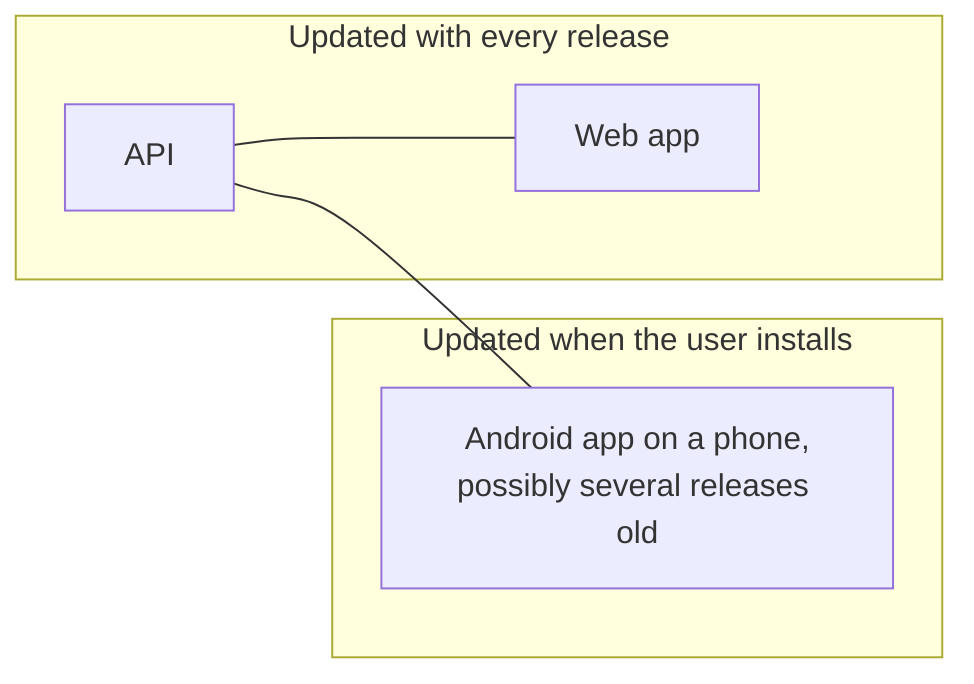

# The API contract

Two apps, a demo-data generator and several test suites all talk to one GraphQL API. This page
explains how they stay in agreement: where the contract is defined, how each consumer gets it, the
conventions every operation follows, and how a change is kept from breaking anything already
deployed or installed.

## One schema, published

`mootmaker-api/api/mootmaker.graphql` is the contract. Everything else is derived from it.

- **When the schema changes on `main`**, `publish-schema.yml` publishes it to npmjs.com as
  `@mootmaker/schema`, at the version in `api/package.json`. Bump that version in the same pull request;
  a repeat version fails the workflow with a message saying so.
- **The web app generates** its types and operation hooks with `npm run codegen`, from the sibling
  mootmaker-api checkout when there is one, or from the published package otherwise. The generated
  files are committed, and a PR check fails if they are out of date. A field that no longer exists is
  a compile error.
- **The Android app downloads** the package at a version pinned in `data/build.gradle.kts`, and Apollo
  Kotlin generates its operations from it at build time. Moving to a newer schema is a deliberate
  version bump.
- **demo-data and the API's acceptance tests** still write their GraphQL as strings, checked only by
  running against a real API.

## Conventions every operation follows

**One query for screens.** `workspace(dates: [...])` returns everything a screen needs in one call:
the caller (`me`), rooms, people, the requested days, and the booking window. Fields not selected are
not fetched, so asking for less costs less. `meeting(id:)` and `suggestRoom(...)` are the only other
queries.

**Validation failures are data; refusals are errors.** These are two different channels, and a client
must handle both:

- **Every rule broken is reported at once.** A rejected booking lists every reason, so a form can show
  them all.
- **Error codes are enums**, one per entity (`RoomError`, `PersonError`, `MeetingError`, and so on),
  and each has a Java enum with exactly the same constant names. Add a code in both places. Both apps
  map codes to their own wording; the web app's map is typed by the generated enum, so a new code does
  not compile until it has a message, and the Android app falls back to a generic message for a code
  it does not know.
- **Mutations return what changed.** `createMeeting` returns the meeting *and* its whole day, so a
  client's cache can take the new state without refetching.

**Times are zone-less local date-times** (`2026-10-14T10:00:00`). See
[time and time zones](time-and-time-zones.md).

**Ids are opaque strings.** Clients never create them and never parse them.

## Not breaking what is already out there

The API, the web app and installed Android apps change at different times:

So a schema change has to keep working for clients that have not caught up. Four checks enforce it:

| Check | Where | Catches |
|---|---|---|
| `schema-parses` | mootmaker-api PR checks | A schema that standard GraphQL tooling rejects (AppSync is more forgiving) |
| `schema-compatible` | mootmaker-api PR checks | A breaking change against the base branch: a removed field, a renamed type, a tightened argument. Fails unless the PR carries the `allow-breaking-schema-change` label |
| Pre-deploy compatibility check | mootmaker-webapp `deploy.sh` | Deploying a web app whose operations use fields the target API does not serve. It introspects the live API and lists every missing field |
| n-1 smoke test | mootmaker-release | The previous release's APK no longer working against the new API. Runs against `test` before `production` is touched |

**To remove or rename a field**, mark it `@deprecated` and keep it. Remove it only once no Android
release still in use selects it. How many releases back that has to cover has not been decided yet;
look at the Android app's pinned schema version in recent release tags.

**To add a field**, add it to the API first and release, then use it in the clients. Merging a client
change first would make its next release fail the pre-deploy check, or the n-1 check.

## Where to look

| Concern | Location |
|---|---|
| The schema | `mootmaker-api/api/mootmaker.graphql` |
| Publishing | `mootmaker-api/.github/workflows/publish-schema.yml`, `api/package.json` |
| Web codegen | `mootmaker-webapp/webapp/codegen.ts`, `src/graphql/generated/` |
| Web error wording | `mootmaker-webapp/webapp/src/graphql/validationMessages.ts` |
| Android schema version | `mootmaker-android/data/build.gradle.kts` |
| Android error wording | `mootmaker-android/data/.../meeting/AddMeeting.kt` and the other feature files |
| Deployed-schema check | `mootmaker-webapp/deploy/verify-schema-compatibility.sh` |
