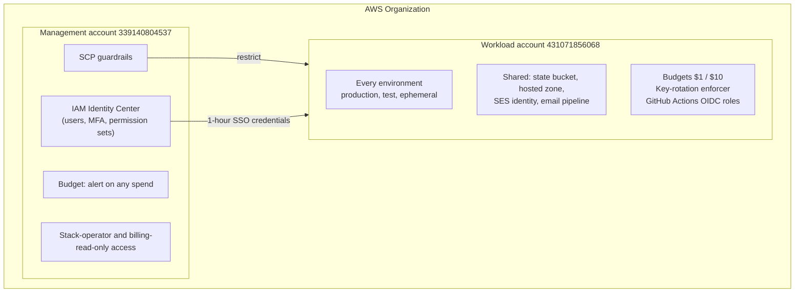
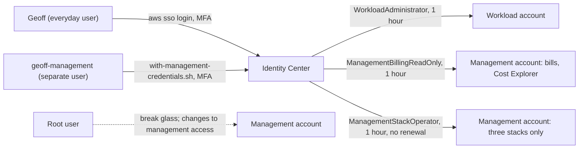

# AWS accounts

How the AWS side is set up underneath every environment: the accounts, how people and automation get
into them, the guardrails, and the few shared resources everything stands on. All of it lives in
[mootmaker-bootstrap-aws-accounts](https://github.com/geoffweatherall/mootmaker-bootstrap-aws-accounts),
[mootmaker-bootstrap-terraform](https://github.com/geoffweatherall/mootmaker-bootstrap-terraform) and
[mootmaker-domain](https://github.com/geoffweatherall/mootmaker-domain).

## Two accounts



| Account | Holds | Day-to-day access |
|---|---|---|
| **Management** (`339140804537`) | The Organization, the SCPs, IAM Identity Center, one budget. No workloads | Billing read-only for the everyday user. Changes need a separate user (below) |
| **Workload** (`431071856068`) | Every environment and every shared resource | `WorkloadAdministrator` through SSO |

Everything runs in **`us-east-1`**, which the SCPs enforce. CloudFront certificates have to be in
`us-east-1` anyway, and one region keeps the account simple to audit.

## Getting access

Day-to-day access is through IAM Identity Center (SSO), with MFA. There are no IAM users and no
access keys. A new machine needs exactly this in `~/.aws/config`, and nothing in
`~/.aws/credentials`:

```ini
[default]
sso_session = mootmaker
sso_account_id = 431071856068
sso_role_name = WorkloadAdministrator
region = us-east-1

[profile mootmaker-billing]
sso_session = mootmaker
sso_account_id = 339140804537
sso_role_name = ManagementBillingReadOnly
region = us-east-1

[sso-session mootmaker]
sso_start_url = https://d-90667673bd.awsapps.com/start
sso_region = us-east-1
sso_registration_scopes = sso:account:access
```

Then `aws sso login`. The role credentials last one hour and are renewed silently for as long as the
SSO session lasts (up to a day; an Identity Center setting in the management account), so `deploy.sh` and Terraform just work. When the session ends, commands
fail with `ExpiredToken` or `NoCredentials`; run `aws sso login` again.



- **The management account's stacks** are changed by a separate Identity Center user,
  `geoff-management`, through `management-account/with-management-credentials.sh`. It signs in, takes
  one hour of `ManagementStackOperator` credentials, signs the session straight out, and runs the
  command. That role can only change the `scp-guardrails`, `billing-alert` and `identity-center`
  stacks, and only through a CloudFormation service role. Keeping it on a separate user means the
  everyday SSO token can never reach it.
- **The root user** is the fallback if Identity Center is unreachable, and is still needed to change
  who can get into the management account (the `management-access` stack).

## Guardrails

**Service control policies** (`scp-guardrails` stack), attached to the workload account:

- **Region allow-list**: only `us-east-1`, apart from AWS's global services (IAM, Route 53,
  CloudFront, STS, Organizations, Support).
- **Service allow-list**: only the services the system uses. Anything else, EC2 included, is denied
  by omission. A new AWS service has to be added to the list in **two** templates,
  `scp-guardrails.yaml` and the permission set in `identity-center.yaml`, and the change applied to
  the management account before anything can use it.

**Budgets** email Geoff:

| Account | Threshold | When |
|---|---|---|
| Workload | $1 a month | Forecast or actual |
| Workload | $10 a month | Forecast or actual |
| Management | $0.01 | Actual. Anything at all is a tripwire, because nothing should run there |

The first two budgets in an account are free, and the workload account uses exactly two.

**Credential rotation** (`credential-rotation` stack): a daily Lambda deactivates any IAM access key
older than 90 days. There are no IAM users, so it normally has nothing to do.

## Changing the account setup

Every stack is applied from the command line with `deploy-stack.sh`, named after its template file
(`workload-account/billing-alert.yaml` is the stack `billing-alert`):

```bash
./deploy-stack.sh workload-account/billing-alert.yaml pLowBudgetUsd=2
management-account/with-management-credentials.sh ./deploy-stack.sh management-account/scp-guardrails.yaml
```

It checks the credentials belong to the right account, shows the template diff and the change set,
and applies only after a `y` at a terminal. Without a terminal it previews and then deletes the change
set, so an AI agent can show a change but never apply it.

## Shared foundations

| Resource | Repository | Notes |
|---|---|---|
| Terraform state bucket `remote-state-431071856068` | mootmaker-bootstrap-terraform | Encrypted, versioned, old versions kept 30 days. Every component and environment has its own key, `<environment>/<repository>/terraform.tfstate`, locked with S3 lock files. A `KEEP` object under an environment's prefix stops the sweep destroying it |
| Hosted zone `mootmaker.com` | mootmaker-domain | The registrar is Porkbun, delegating to Route 53's nameservers. Every environment adds its own records and certificates. DNS query logs go to CloudWatch for 14 days |
| `mootmaker.com` → `www.mootmaker.com` redirect | mootmaker-domain | A CloudFront function answers before any origin is read |
| SES identity `mail.mootmaker.com` | mootmaker-domain | Verified with DKIM. Cognito sends from it; its MX record delivers inbound mail to SES. The account has SES production access (50,000 emails a day) |
| Email-reading pipeline | mootmaker-email-testing | The account's single active SES receipt rule set, `mootmaker-e2e-inbound`, catches mail to `mail.mootmaker.com` and passes it via SNS to an SQS queue that tests read |

## Service limits

The defaults that matter, and where they have been raised:

| Limit | Value | Why it matters |
|---|---|---|
| Lambda concurrent executions | 1,000 (raised from 10) | Parallel release builds and acceptance runs each start several Lambdas; demo-data reserves one |
| SES receipt rule sets | One active per region | Why the email pipeline is shared rather than created per environment |
| Budgets free per account | Two | The workload account already uses both |
| Cognito user pool, AppSync APIs, CloudFront distributions | Account defaults | Each ephemeral environment uses one pool, one API and two distributions; many environments at once can approach these |

## Checking the account as a whole

Two read-only scripts in mootmaker-bootstrap-aws-accounts look at the account rather than one
environment:

- **`list-unmanaged-resources.sh`** lists anything that no Terraform state or CloudFormation stack
  claims: resources made by hand, or left by a half-finished destroy. Run it after finishing work
  and after a release, and expect `Nothing needs attention`.
- **`check-accumulation.sh`** fails if anything is growing with time rather than use: log groups
  without retention, Lambdas keeping more than four published versions, or a history-cleanup job
  that has stopped advancing. It runs daily in the ephemeral-envs sweep.
