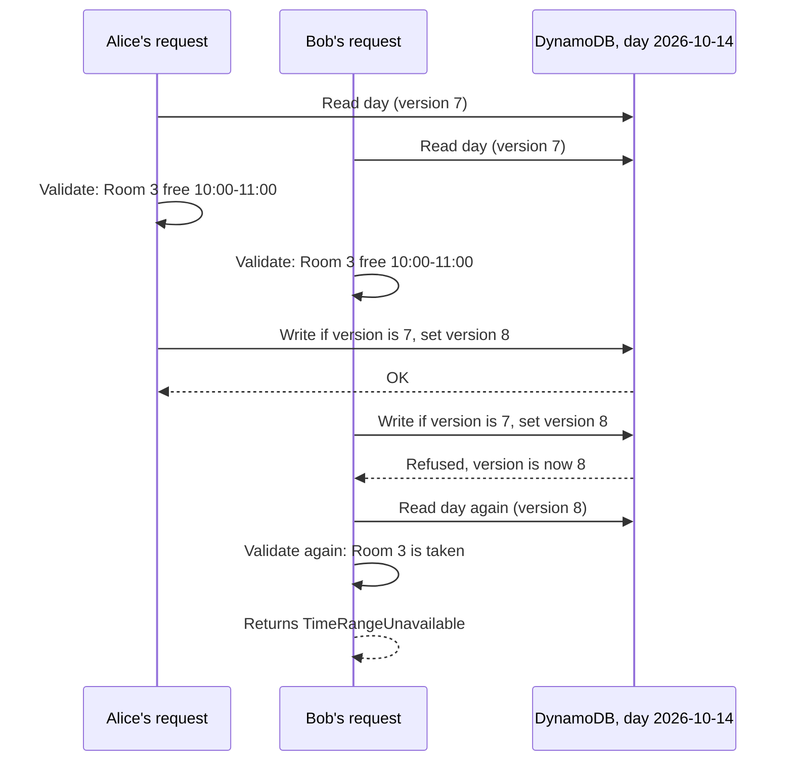
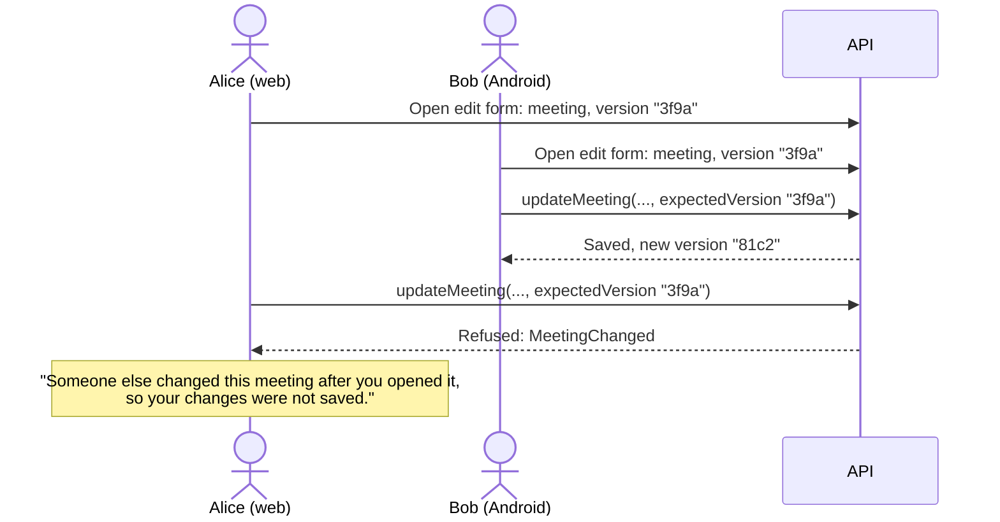
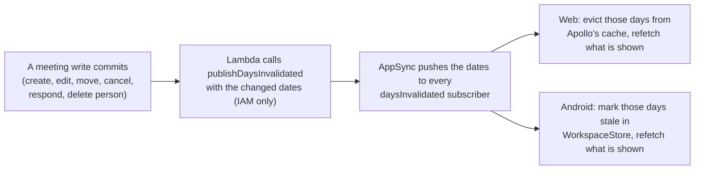

# Concurrent updates

Many people use Mootmaker at once, on the web and on Android. This page explains what happens when
two of them change the same thing, and how a change made by one reaches everyone else's screen.

There are two separate problems, solved in two separate places:

1. **Two writes at once must not corrupt or silently undo each other.** Solved on the server, by the
   API and DynamoDB.
2. **Everyone's screen must stop showing what is no longer true.** Solved by a broadcast from the
   server and by each client's cache.

[The live-updates talk](../showcase/live-updates-talk-short.md) and its
[deep dive](../showcase/live-updates-deep-dive.md) tell the web side of this story in more detail.

## Writes: one item per day, with a version

Every meeting on a calendar date lives in **one DynamoDB item for that day**, which carries a
`version` number. Every change to a meeting is a read, a change in memory, and a write that succeeds
only if the version is still the one that was read:

- **Every rule is re-checked against the day as it now is**, on every retry. A booking can never be
  accepted on the strength of a day that has since changed.
- **A write is retried up to five times.** Contention on one date is low at this scale; failing all
  five means sustained contention and surfaces as an error.
- **The write and the meeting's id pointer go in one transaction**, so a meeting can never exist
  without the pointer that finds it by id, or the other way round.
- **Moving a meeting to another day** is two writes: add to the new day, then remove from the old.
  If it stops between them, the meeting shows on both days until a retry finishes the move. It can
  never vanish from both.

This makes "two people booked the same room at the same time" impossible, whichever client they
used.

## Edits: refusing a stale form

The day version protects the *storage*. It does not stop a person undoing someone else's change: if
Alice opens the edit form, Bob then moves the meeting to another room, and Alice saves, a plain
update would put the meeting back the way Alice's form remembered it.

So every meeting has its own **version**: a fingerprint of everything an edit can change (room,
organiser, attendees, subject, start and end). The client sends back the version it edited:

- Both clients send `expectedVersion` on every edit and show the same message on `MeetingChanged`.
- **Attendee responses are not part of the version.** An attendee answering Going or Not going does
  not block the organiser's edit, and an edit keeps everyone's existing responses.
- A meeting cancelled while someone edits it comes back as `MeetingNotFound`.

## Other kinds of change

| Change | What protects it | When two happen at once |
|---|---|---|
| Book, edit, cancel, respond to a meeting | The day version (above) | Each is re-validated against the latest day; nothing is lost |
| Edit a meeting from a stale form | The meeting version | The later save is refused with `MeetingChanged` |
| Rename a person, set admin, change preferences | An attribute-level update on that one person, which must still exist | The last write wins. Fields not being edited are never touched |
| Edit a room | The whole room item is replaced | The last write wins. A room edit racing the room's deletion can recreate the room ([mootmaker-api#112](https://github.com/geoffweatherall/mootmaker-api/issues/112)) |
| Delete a room | Refused if any meeting from now on uses it | A booking that lands just before the delete makes the delete fail |
| Delete a person or account | Cancels their upcoming meetings and removes them as an attendee, day by day, with the same day versions | Each day is re-read and re-written safely |
| Set an avatar | One object per person, chosen by content hash; the record is updated last | The last confirmed upload wins; leftovers are swept on the next upload |

## Reads: telling every screen what changed

After any write that changes meetings commits, the resolver Lambda publishes the **dates** that
changed. Every connected client receives them over AppSync's realtime WebSocket and refetches what
it is showing for those dates.

**Why dates and not the data.** A day's worth of meetings can be larger than AppSync allows in one
subscription message (240 KB), so sending data would sometimes silently fail. A list of dates is
always small, means the same thing for every kind of change, and is safe to receive twice.

**Only meeting changes are broadcast.** Rooms and people are not. A client picks up a renamed room
or a new person when it refetches its reference data: on a reconnect, when the app or tab comes back
to the foreground, or on a page load. The
[live-update-origin-and-reference-data](../../designs/live-update-origin-and-reference-data.md)
design, still being drafted, proposes broadcasting those too.

**A broadcast can be missed, and that is designed for.** Browsers freeze background tabs, phones lock
and AppSync closes idle sockets. So the rule on both clients is: after any reconnect, or on returning
to the foreground, **treat everything held as stale** and refetch what is on screen. Nothing relies on
the socket having stayed up, and there is no replay to ask for.

**A failed broadcast does not fail the write.** By the time the broadcast is sent the change is
saved. Other screens catch up at their next refetch.

## How each client keeps its cache honest

The two apps follow the same rules with different machinery:

| | Web app | Android app |
|---|---|---|
| Cache | Apollo `InMemoryCache`. Days are cached entities keyed by date, shared by every page | `WorkspaceStore`, the app's own in-memory store of days, reference data and meetings |
| On a broadcast | Evict those days; refetch only the watched queries the eviction changed | Mark those days stale; refetch the ones a screen is watching |
| After reconnect or return to foreground | Evict every held day; refetch every active query | Mark everything stale; refetch what is shown (on resume, only if older than five minutes) |
| Its own writes | A date this tab wrote is ignored for 5 seconds, so the broadcast of its own change does not throw away the fresher result it already holds | Invalidates what it changed |
| A response in flight when its date changed | Re-evicted and refetched when it lands (`reconcileLink`) | Fetched again |
| Shown while refetching | The old data stays, with a thin progress bar | The old data stays, with a thin progress bar |
| Signing out | The cache is cleared | The store is emptied |

**The in-flight race** is the subtle one. Bob's screen asks for a day at 10:00:00.0. Alice's booking
commits at 10:00:00.1 and the broadcast evicts the day on Bob's screen. Bob's original request then
lands at 10:00:00.2 carrying the old day, and would refill the cache with stale data that nothing
would ever correct. Both clients record when each date was last invalidated, and fetch again any
response that was requested before that moment.

**The web app's 5-second grace for its own writes** has a known cost: if someone else changes the
same date within those 5 seconds, this tab does not see it until its next refetch. That trade was
made deliberately.

## Where to look in the code

| Concern | Code |
|---|---|
| Day read-modify-write and retries | `DayRepository` in mootmaker-api |
| Meeting version | `MeetingVersion` in mootmaker-api; `meetingVersion.ts` in the webapp |
| Publishing the broadcast | `DaysInvalidatedPublisher` in mootmaker-api |
| Web subscription and cache rules | `webapp/src/realtime/` in mootmaker-webapp |
| Android subscription and store | `data/.../live/` and `data/.../cache/WorkspaceStore.kt` in mootmaker-android |
