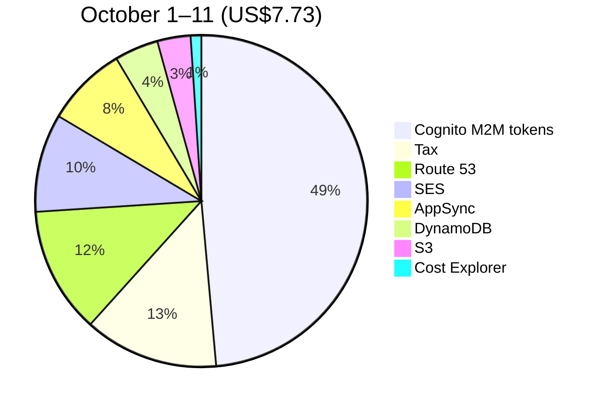

# Cost and scale to zero

Mootmaker costs a few US dollars a month, nearly all of it caused by building and testing it rather
than by anyone using it. This page explains why, what each design choice does for the bill, and what
is still charged when nothing is happening.

## The two rules

Every cost decision follows from one of two rules in the [principles](../process/principles.md#cost):

- **Scale to zero.** Nothing should cost money while nobody is using it. This governs what *runs*.
- **Nothing accumulates without a bound.** Under steady use the bill should be flat. Anything that
  grows with time rather than with use (logs, old versions, stored history) needs something that
  deletes it. This governs what *piles up*.

A system can satisfy the first and still fail the second: it idles at zero but stores a little more
every month, forever. Both are checked.

## What it costs

Cost Explorer for the workload account, in US dollars (the management account costs nothing):

| Service | September 2026 | October 1–11, 2026 | What drives it |
|---|---|---|---|
| Cognito | 1.88 | 3.75 | Machine-to-machine tokens for tests: US$2.25 per 1,000 |
| Tax | 0.80 | 1.01 | GST on the rest |
| Route 53 | 0.92 | 0.95 | The hosted zone (US$0.50 a month) and DNS queries |
| SES | 1.03 | 0.74 | Test emails: each test sign-up sends one and receives it back |
| AppSync | 0.72 | 0.61 | GraphQL calls, mostly from test suites |
| DynamoDB | 0.45 | 0.33 | Reads and writes, mostly from test suites |
| S3 | 0.20 | 0.25 | Uploads when environments deploy the web app |
| Cost Explorer | 0.11 | 0.08 | US$0.01 per query |
| **Total** | **6.11** | **7.73** | |

Rules of thumb, from the daily figures in [cost-reduction.md](../../designs/cost-reduction.md):

- **A day with nothing happening costs about US$0.02**, nearly all DNS queries.
- **A release costs about US$0.12**: four acceptance runs in four ephemeral environments, a deploy to
  `test` and `production`, and the smoke tests.
- **A failed release costs nearly as much as a successful one**, because the parallel builds have
  usually run before anything fails.
- **An ephemeral environment costs almost nothing while idle.** It is the deploys and test runs in it
  that cost.

Lambda, CloudFront, CloudWatch, EventBridge, SSM and KMS have stayed inside their free allowances and
show as zero.

## How each part scales to zero

| Part | Choice | Charged | Idle cost |
|---|---|---|---|
| API | AppSync, not a server or API Gateway with a container | Per request | 0 |
| Business logic | Lambda, not containers; no provisioned concurrency | Per request and duration | 0 |
| Data | DynamoDB on demand, not provisioned capacity | Per read and write, plus storage | Storage only, a few MB |
| Web hosting | S3 and CloudFront, not a web server | Per request and transfer | 0 |
| Avatars | S3 and CloudFront | Per request; a few MB stored | Near 0 |
| Accounts | Cognito | Per monthly active user (first 10,000 free), and per M2M token | 0 |
| Email | SES, à-la-carte pricing | Per email | 0 |
| Configuration | SSM standard parameters; `SecureString` on the AWS-managed key | Free | 0 |
| TLS certificates | ACM, one per hostname | Free with CloudFront and AppSync | 0 |
| Schedules | EventBridge rules invoking Lambda directly | Free | 0 |
| Networking | No VPC, no NAT gateway, no load balancer | n/a | 0 |
| CI | GitHub Actions on public repositories | Free | 0 |

## What does not scale to zero

| Cost | About | Why it is accepted |
|---|---|---|
| Route 53 hosted zone | US$0.50 a month | Makes every environment addressable by name. There is no cheaper way to run a domain on AWS |
| DNS queries | US$0.50–0.70 a month idle | Mostly scanners querying hostnames they found in public certificate logs. Each ephemeral environment's certificates publish three more names, which keep attracting queries after it is gone. [Measure 1](../../designs/cost-reduction.md#measure-1-stop-publishing-ephemeral-hostnames) proposes stopping that |
| Domain registration | Annual, at Porkbun | Billed outside AWS |
| Tax | A share of everything | Pass-through |

## Choices made for cost, and why

| Choice | Saves | Instead of |
|---|---|---|
| Every component scales to zero (above) | Everything while idle | Always-on servers costing tens of dollars a month |
| One shared email-reading pipeline, not one per environment | Avoids SES's one-active-rule-set limit and per-environment setup | A receipt rule set per test run, fighting over which is active |
| AWS-managed key for secrets in SSM | US$1 a month per key per environment | A customer-managed KMS key |
| M2M tokens cached for a whole test run | About 110 tokens (US$0.25) per release | A token per test class |
| SES à-la-carte pricing (2026-10-11) | 37% of outbound email cost | The Essentials plan new accounts default to |
| Fail fast in releases: once one build fails, the others stop | Acceptance runs that could not lead to a release | Finishing every build regardless |
| Ephemeral environments swept after 48 idle hours | Forgotten environments | Relying on people to remember |
| Two free budgets, not more | US$0.02 a day per extra budget | More granular alerts |

## What would grow, and what deletes it

| Grows with time | Deleted by |
|---|---|
| Meeting days | `history-cleanup`, weekly: days older than 30–37 days |
| Log events | Retention on every log group: 120 days (Route 53 query logs: 14) |
| Lambda versions, one per API deploy | `prune-lambda-versions.sh` on every API deploy: keeps the live version and the newest three |
| Staged avatar uploads | S3 lifecycle rule: 1 day |
| Old Terraform state versions | S3 lifecycle rule: 30 days |
| Ephemeral environments | The daily sweep, after 48 hours without a state write |
| Log groups of deleted functions and APIs | The daily sweep |
| GitHub workflow artifacts | Artifact retention: 14 to 90 days |

Meetings are bounded at both ends: nothing can be booked more than 180 days ahead, and history is
deleted after 30–37 days, so the meetings table holds at most about 217 day items whatever happens.
People and rooms do not grow on their own; demo-data stops at its targets (100 people, 10 rooms).

**How this is checked.** `check-accumulation.sh` in mootmaker-bootstrap-aws-accounts runs daily in
the sweep and fails if any log group lacks retention, any Lambda keeps more than four versions, or
history cleanup has stopped advancing. `list-unmanaged-resources.sh` finds anything no Terraform or
CloudFormation claims. Budgets email at US$1 and US$10 a month. See the
[higher-than-expected bill runbook](../runbooks/higher-than-expected-bill.md).

## Spending rules for people and agents

Before creating anything in AWS, say what it costs. Under NZ$1, one-off: go ahead and state the cost.
NZ$1 or more, or anything recurring: ask first. Report money in NZ dollars, saying what it was
converted from. The full rule is in the [process docs](../process/README.md#rules-that-apply-to-every-piece-of-work).

## What would change the picture

- **Real usage.** At demo scale every service is inside or near its free tier. Nothing here says what
  1,000 daily users would cost; the system is proportional, not proven cheap at scale.
- **Cognito monthly active users.** Every test account in every environment counts against the
  account-wide 10,000 free. September had 3,469.
- **Free tiers that expire.** Some AWS free allowances last only twelve months from account creation.
  Lambda, CloudWatch and CloudFront could start showing small charges with nothing having changed.
- **Release frequency.** Most of the bill is releases and test runs, so it moves with how much
  development is happening.
