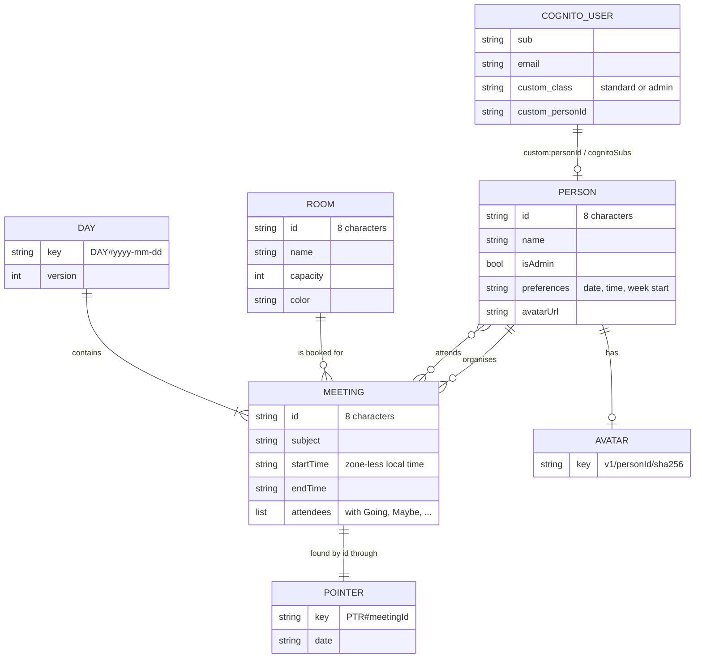
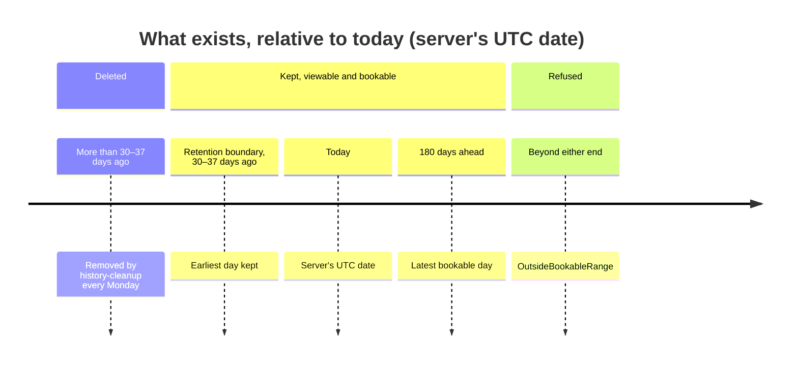

# Data

What Mootmaker stores, where, for how long, and the limits that keep it bounded. The attribute-level
reference (every table, key and field) lives with the code that owns it, in
[the data model reference](../reference/data-model.md).

## Where data lives

| Store | Holds |
|---|---|
| Cognito user pool | Accounts: email, password, role (`custom:class`), and the id of the account's Person |
| DynamoDB `<env>-mootmaker-people` | People, with or without an account |
| DynamoDB `<env>-mootmaker-rooms` | Rooms |
| DynamoDB `<env>-mootmaker-meetings` | One item per calendar day holding all of that day's meetings, a pointer per meeting, and one config item holding the retention boundary |
| S3 `<env>-mootmaker-avatars-<account>` | Normalised avatar images, and uploads waiting to be confirmed |

All three tables are on-demand billing, with no secondary indexes.

## Why meetings are stored a day at a time

The obvious design stores one item per meeting. Mootmaker stores **one item per calendar day** instead,
because every screen asks for whole days (today and tomorrow, a week, the six weeks of a calendar), and
this makes each of those a handful of direct key reads:

- **Reads are by key and strongly consistent.** A client asks for a list of dates and gets exactly
  those days, never stale. There is no query that scans all meetings, so read cost follows what was
  asked for, not how much is stored.
- **Writes are safe under contention.** Each day has a version number; see
  [concurrent updates](concurrent-updates.md).
- **The live-update message is just a date.** Every client's cache is organised by day too.

The trade-offs, accepted deliberately:

- **A write rewrites the whole day.** The last booking on a busy day costs more than the first.
- **A day has a size limit.** DynamoDB items are capped at 400 KB, so a day holds at most 320
  meetings, and the API refuses the 321st with `DayIsFull` even if a room is free.
- **A meeting cannot span midnight.** It has to fit in one day's item.

A meeting is looked up by id (for a shared link) through a small **pointer item**, `PTR#<id>`, which
names its date. The pointer is written and deleted in the same transaction as its day.

Meetings store ids, not names. Renaming a room or person changes it everywhere at once.

## The window of meetings

- **One window for viewing and booking.** Any day from the retention boundary to 180 days ahead can
  be read and booked, including days already past. Outside it, a booking is refused with
  `OutsideBookableRange`. The horizon is computed from today, never stored.
- **Retention: 30 to 37 days back.** `history-cleanup` runs every Monday at 14:17 UTC (in `test` and
  `production`), deletes days before the Monday on or before 30 days ago, and moves the stored
  boundary forward. The boundary only ever moves forward.
- **The server is the only authority on both dates.** It returns them to the apps
  (`workspace { boundaries }`), which never compute them, so a phone with a wrong clock or in a far
  time zone cannot ask for a day the server has deleted. See [time and time zones](time-and-time-zones.md).

Together these cap the meetings table at about 217 day items, however long the system runs.

## Limits

Every size limit is in `Limits.java` in mootmaker-api, which checks at start-up that they are
consistent with each other and with the platform's caps. An inconsistent set fails the deploy, not a
user's booking.

| Limit | Value | Because |
|---|---|---|
| Meetings per day | 320 | A day item must fit DynamoDB's 400 KB |
| Attendees per meeting | 20 | The same |
| Meeting subject | 280 bytes of UTF-8 | The same; bytes, because that is how DynamoDB measures |
| Room and person names | 100 bytes | The same |
| Rooms | 200 | Listing rooms reads the whole table |
| People | 1,000 | Listing people reads the whole table |
| Dates per request | 42 | Six weeks, the calendar's span, plus a week |
| Meetings per response | 2,000 | AppSync responses are capped at 5 MB |
| Meetings per bulk create | 99 | One day item plus 99 pointers is DynamoDB's 100-item transaction limit |
| Room capacity | At least 2 | A meeting has an organiser and at least one other seat |
| Meeting times | Quarter hours only | Business rule |

## Ids

Rooms, people and meetings get **8-character random ids** (base62, about 2 × 10^14 possibilities).
Shorter than a UUID because every id is stored many times inside day items, and short ids leave room
for more meetings per day. Each create checks the id is unused and draws again if not.

## Avatars

An avatar is uploaded straight to S3 with a presigned URL, then confirmed. Confirming decodes the image,
writes a 256 × 256 JPEG to `avatars/v1/<personId>/<sha256-of-upload>.jpg`, points the Person at it, and
deletes that person's other avatars. Unconfirmed uploads expire after a day. Avatars are served by
their own CloudFront distribution at `avatars.<env>.mootmaker.com`, and because each URL contains a
hash of the image they are cached for a year. A deleted avatar can stay in a CDN edge cache for a
while; that was accepted rather than paying for an invalidation on every delete.

## Resetting and repairing an environment

Two Lambdas in mootmaker-api change data in bulk. Neither is reachable through the API; both are
invoked with AWS credentials (`aws lambda invoke`).

| Lambda | Does | In `production` |
|---|---|---|
| `<env>-mootmaker-database-reset` | Deletes every room and meeting, and avatars of people who do not survive. Outside `production`, also deletes every Cognito user except the reserved accounts, and every Person not linked to a surviving account; then recreates and repairs the test fixture users | Deletes rooms and meetings, keeps every Person linked to an account, and never touches Cognito (a Terraform setting, not a runtime flag) |
| `<env>-mootmaker-database-repair` | Creates the missing Person for any confirmed account without one. Supports `{"dryRun": true}` | Same |

Test suites call reset before they run. demo-data never deletes anything; to refill an environment
from scratch, reset it and then run demo-data. See the
[reset an environment runbook](../runbooks/reset-an-environment.md).

## Backups

There are none. DynamoDB point-in-time recovery is off and nothing copies the tables, because every
environment's data is disposable: `production` is a demo that demo-data refills. The only data that
could not be regenerated is what real visitors enter, and the demo makes no promise to keep it.
