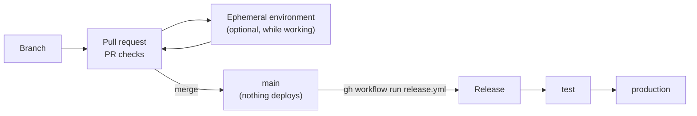
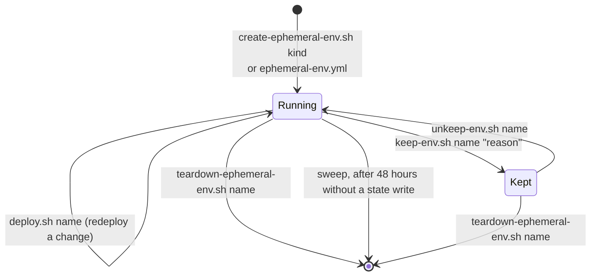
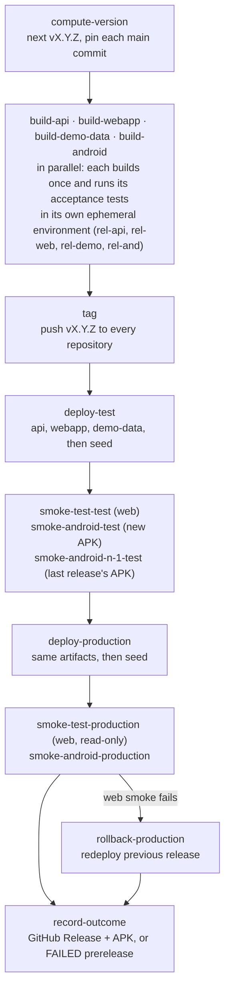

# Delivery

How a change gets from a branch to `production`: the environments it passes through, the checks
along the way, and what happens when something fails.

## The path of a change

1. **Work on a branch, open a pull request.** Each repository's PR checks run automatically; see
   [GitHub](github.md#what-github-actions-runs). To try a change against real AWS, deploy it to an
   ephemeral environment of your own.
2. **Merge to `main`.** Nothing is deployed. `main` in every repository is always meant to be
   releasable.
3. **Start a release when you mean to.** `gh workflow run release.yml -R geoffweatherall/mootmaker-release -f bump=patch`.
   The release takes whatever is on `main` in each component at that moment, builds it once, and
   promotes that one build through `test` to `production`.

There is no other route to `test` or `production`. Running a component's `./deploy.sh production`
by hand is possible (nothing technically blocks someone holding production credentials), but it
skips the tests, the tag, the rehearsal and the rollback, and leaves `production` running something
no release can name. It is for recovering a broken pipeline, not for shipping.

## Environments

| Environment | Lifetime | Changed by | Data |
|---|---|---|---|
| `production` | Permanent | Releases only | The public demo. Demo data is topped up daily. Real visitors may sign up |
| `test` | Permanent | Releases only | Seeded by every release. Never reset, so its history looks like `production`'s |
| Ephemeral | Hours | Anyone: people, agents, CI | Whatever the work needs. Destroyed when the work is done |

An environment is just a name. Every component's `deploy.sh <name>` creates or updates that
environment's copy, with resources named `<name>-mootmaker-*`, hostnames `*.<name>.mootmaker.com`
and Terraform state under `<name>/` in the state bucket. There is no registry. Each script also sets
`TF_DATA_DIR=.terraform-<name>`, so one checkout can work on several environments at once without their
local Terraform metadata colliding. Every script requires the name explicitly; there is no default.

**`test` is the rehearsal stage.** Each release deploys there first and runs the full smoke test,
including a real sign-up with a real emailed code, before `production` is touched. Because `test`
is never rebuilt from scratch, a release that would break on an environment with history fails
here. A failure leaves `test` as it is, deliberately, for diagnosis; the next release's deploy to
`test` will fail too until someone fixes it.

### Ephemeral environments

Named `<kind>-<YYMMDD>-<rand4>`, for example `claude-261012-x7q2`. The kind says what created it:

| Kind | Created by |
|---|---|
| `claude` | An AI session working on a change |
| `web-acc` | mootmaker-webapp's `acceptance/run.sh` |
| `and-acc` | mootmaker-android's acceptance run on a labelled pull request |
| `rel-api`, `rel-web`, `rel-demo`, `rel-and` | Each component's acceptance run inside a release |
| A person's name, e.g. `geoff` | Someone's own manual testing |

- **Create** with `mootmaker-ephemeral-envs/create-ephemeral-env.sh <kind>`. It deploys the API and
  the web app; `--with-demo-data` also deploys and seeds demo data; `--keep "<reason>"` marks it kept.
  A cloud session dispatches `ephemeral-env.yml` instead and reads the name from the job summary.
- **Tear down** with `teardown-ephemeral-env.sh <name>`. It finds what is deployed by listing the
  environment's state prefix, undeploys each component, and fails loudly if anything is left. It
  refuses any name that does not match the ephemeral pattern, so a typo cannot reach `production`.
- **Forgotten environments are swept.** `sweep.yml` runs daily at 06:00 UTC and destroys any
  ephemeral environment whose state has not been written for 48 hours, unless it carries a KEEP
  marker (`s3://remote-state-<account>/<name>/KEEP`). The sweep measures state writes, not use, so
  keep an environment you are testing in by hand.
- **Tearing down your own environment is part of finishing the work.** An ephemeral environment
  costs a little while it exists; see [cost](cost-and-scale-to-zero.md#what-it-costs).

## The release pipeline

What each stage guarantees:

- **One build, promoted.** Each component is built once in its `release-build.yml`, with its unit and
  acceptance tests run against a fresh ephemeral environment. The same artifacts are deployed to
  `test` and then `production` with `deploy.sh --skip-build`; nothing is rebuilt per environment.
- **Fail fast.** Once one build fails, the others stop at their next check rather than finishing
  acceptance runs for a release that can no longer tag.
- **A tag always names proven code.** Tags are pushed only after all four builds pass. A release that
  fails later never reuses its version: the next attempt computes a new one, and the failed one is
  recorded as a `FAILED` prerelease. **Retry a failed release with `bump=patch`**, whatever bump the
  failed attempt used, or the bump is counted twice.
- **`test` rehearses the deploy.** API first (it publishes the settings the others read), then the
  web app, then demo-data, then a seed. The smoke tests then sign up a real account with a real
  emailed code, book a meeting, reset the password and delete the account, through the web app and
  through the new APK.
- **Installed phones keep working.** The n-1 check installs the *previous* release's APK and runs it
  against the new `test`, because installed apps are not replaced when the API deploys. If it fails,
  `production` is not touched.
- **`production` is smoke-tested read-only** as the demo user. If the web smoke test fails,
  `rollback-production` rebuilds and redeploys the previous successful release from its tag, and
  that is smoke-tested in turn. An Android smoke failure in `production` does not roll back; it stops
  the APK being published.
- **The APK is published last**, attached to the GitHub Release only when every stage passed,
  because an APK cannot be withdrawn from phones.
- **Everything is recorded.** Each stage's output is shipped to the `/mootmaker/release-pipeline` log
  group, keyed by version, stage and component; see [operations](operations.md#release-pipeline-logs).

Releases queue rather than run concurrently. A full release takes roughly an hour, most of it the
parallel acceptance runs.

### Before starting a release

The pipeline cannot know whether now is a good moment. Whoever starts it should:

1. **Scan open issues in every repository the release touches**, for a manual step that has to
   happen first, a path this release will exercise for the first time, or anything that makes an
   automatic rollback less useful than usual.
2. **Check what is on each component's `main`.** Anything merged before the run starts is in the
   release, whether or not it was meant for it.
3. **Pick the bump.** `patch` for fixes, `minor` for features, `major` for breaking changes. A retry
   is always `patch`.

mootmaker-release's [README](https://github.com/geoffweatherall/mootmaker-release#before-starting-a-release)
has the commands. If a release fails, see the [failed release runbook](../runbooks/failed-release.md).

## What rollback can and cannot fix

Rollback redeploys the previous release's code. It cannot undo data: DynamoDB items written by the
new code stay, Cognito users stay, and a schema change already applied stays. In practice the
release's own acceptance and `test` stages catch code defects, so a production smoke failure is more
likely to be environmental (an expired certificate, a service limit, a manual change), which
redeploying old code does not fix either. Treat an automatic rollback as a signal to look, not as a
resolution.
