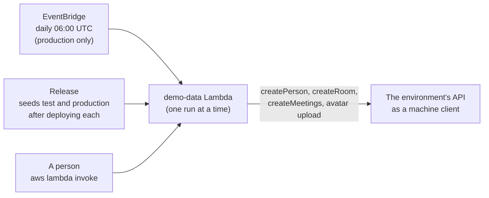
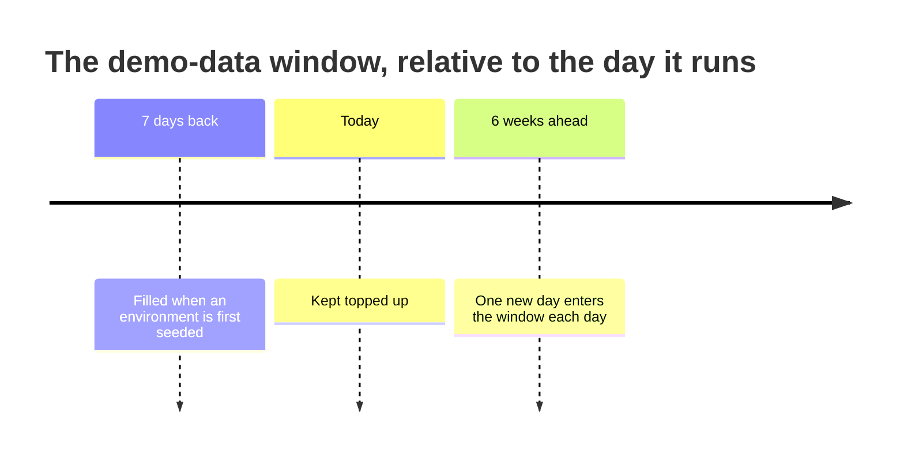

# Demo data

The public site at www.mootmaker.com is a demo: anyone can sign in as the published demo account and
find an office of about a hundred people, ten rooms and a realistic week of meetings. That data is
generated, and keeping it there is part of the product rather than a test aid. This page explains
how. [mootmaker-demo-data's README](https://github.com/geoffweatherall/mootmaker-demo-data#readme)
has the operating detail.

## What a visitor sees

| Data | Amount | Source |
|---|---|---|
| People | 100 | First and last names from curated lists. Nine in ten have a photo |
| Rooms | 10 | Varied names and capacities. Colours are left unset, so the apps assign one by position |
| Meetings | Every weekday from 7 days back to 6 weeks ahead | A daily pattern: busy mid-morning, quiet at lunch, busy again in the afternoon. Some rooms much busier than others; about one meeting in five near the room's capacity |
| The demo account's own meetings | At least one every weekday in the window | So a visitor who opens Calendar never sees an empty week |

**None of the photographs is a real person.** They are 200 images (100 men, 100 women) generated
with Stable Diffusion and bundled in the repository. Each person gets a photo whose apparent sex
matches their first name, and no two people in an environment share one.

## How it stays populated

Each run tops up four independent targets, and does nothing for any target already met:

1. **People** up to 100, counting everyone, including real sign-ups.
2. **Rooms** up to 10.
3. **Meetings** on every weekday in the window that has none yet.
4. **The demo account's meetings** on every weekday in the window where it has none.

So seeding a fresh environment and topping up `production` are the same operation: on an empty
environment every day is missing and gets filled; on a running one only the day that has just entered
the window does. The window moves forward a day at a time, and history cleanup removes old days from
the other end.

## Rules it follows

- **It never deletes anything.** To start from scratch, run mootmaker-api's `database-reset` first,
  then demo-data. Two deliberate commands, neither a surprise.
- **It writes only through the API**, as its own Cognito machine client, using the same mutations the
  apps use. Generated data therefore passes the API's own validation, and every run exercises the
  avatar upload path.
- **It fetches one access token per run**, because Cognito charges for each machine-to-machine token.
- **One run at a time.** The Lambda reserves a concurrency of 1, so an overlapping invocation is
  refused rather than racing.
- **It cannot tell demo people from real ones.** The API does not say who has an account, so real
  sign-ups count towards the 100.

## Where it runs

| Environment | Deployed | Scheduled |
|---|---|---|
| `production` | Always | Daily, and each release seeds it after deploying |
| `test` | Always | No; each release seeds it after deploying |
| Ephemeral | With `create-ephemeral-env.sh --with-demo-data` | No; seeded once when created |

To run it by hand, see the [demo data runbook](../runbooks/demo-data-missing.md). The invocation needs
`--cli-read-timeout 900`, or a long run is reported as failed while it carries on.
