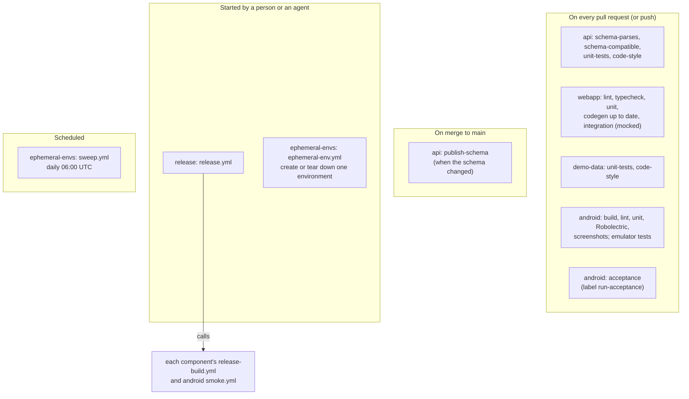
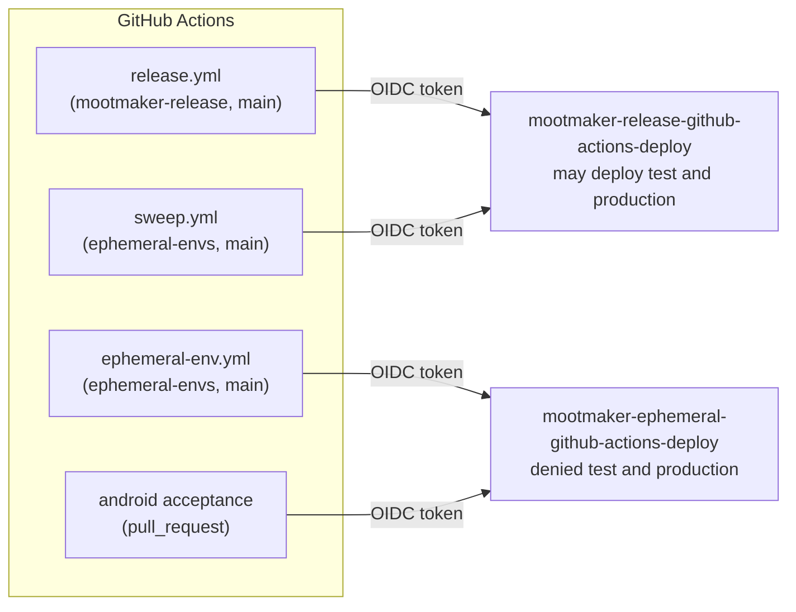

# GitHub

GitHub does more here than host code. It holds every repository, issue and pull request, runs every
automated check, builds and releases the system, publishes the API schema, and is the only way a
cloud AI session can reach AWS. This page covers how each of those is set up. The security side of
it is summarised here and covered in full in [security](security.md).

All repositories belong to the `geoffweatherall` account and are **public**. That is partly the
portfolio point of the project, and partly cost: GitHub Actions minutes are free for public
repositories, which is why CI costs nothing.

## Issues, pull requests and the board

- **An issue lives in the repository whose code it concerns**, so `Closes #12` in that repository's
  pull request closes it. The [process docs](../process/issues-and-board.md) say what a good issue
  contains.
- **The [Mootmaker board](https://github.com/users/geoffweatherall/projects/1)** gathers open issues
  from every repository in one view. Reading it from the command line needs the `project` scope:
  `gh auth refresh -s project`.
- **Every change lands by pull request**, including documentation. There is no approval step: every
  pull request is opened by the same account that would approve it (AI agents act through `gh`
  logged in as Geoff), and GitHub does not let you approve your own. Reading the diff is the review;
  merging is the approval. See [branching and PRs](../process/branching-and-prs.md).
- **Two labels change what CI does.**

| Label | Repository | Effect |
|---|---|---|
| `run-acceptance` | mootmaker-android | Runs the Android acceptance suite on the pull request, in its own ephemeral environment |
| `allow-breaking-schema-change` | mootmaker-api | Lets the `schema-compatible` check pass a breaking schema change |

## Branch protection

Only the three repositories with a deployable backend part protect `main`, and only lightly:

| Repository | `main` protection |
|---|---|
| mootmaker-api | Requires the `unit-tests` check. No force pushes. Admins may bypass |
| mootmaker-webapp | Requires the `pr-checks` check. No force pushes. Admins may bypass |
| mootmaker-demo-data | Requires the `unit-tests` check. No force pushes. Admins may bypass |
| Every other repository | None |

No repository requires a pull request or a review, because with one person there is nobody to
review. The required check stops a red pull request merging by accident; it is not a security
boundary, since the only person with write access is an admin. Note that mootmaker-release and
mootmaker-ephemeral-envs, whose `main` branches can assume the AWS release role, are unprotected;
see [security](security.md#github-and-aws).

## What GitHub Actions runs

| Workflow | Repository | Trigger | What it does |
|---|---|---|---|
| `pr-checks.yml` | api | Pull request | Schema parses with standard tooling; `graphql-inspector` diff against the base branch fails on breaking changes; unit tests; google-java-format, Checkstyle and compiler diagnostics |
| `pr-checks.yml` | webapp | Pull request | Lint, typecheck, unit tests, generated GraphQL code is current, test suites' GraphQL is valid against the schema, Playwright integration tests against a mocked API |
| `pr-checks.yml` | demo-data | Pull request | Unit tests and the same Java style checks as the API |
| `pr-checks.yml` | android | Every push | Build, lint, unit, Robolectric and screenshot tests; instrumented tests on an emulator, including a read-only sign-in against `production` as the demo user |
| `acceptance.yml` | android | Pull request labelled `run-acceptance` | Builds the APK with a throwaway key and runs the acceptance suite in a fresh `and-acc-*` environment |
| `publish-schema.yml` | api | Push to `main` touching the schema | Publishes `@mootmaker/schema` to npmjs.com and `com.mootmaker:mootmaker-schema` to GitHub Packages |
| `release-build.yml` | api, webapp, demo-data, android | Called by `release.yml` | Builds the component once, runs its unit and acceptance tests in a fresh ephemeral environment, uploads the artifact |
| `smoke.yml` | android | Called by `release.yml` | Installs the release APK on an emulator and runs a Maestro flow against `test` or `production` |
| `release.yml` | release | `gh workflow run` only | The release pipeline. See [delivery](delivery.md) |
| `ephemeral-env.yml` | ephemeral-envs | `gh workflow run` only | Creates or tears down one ephemeral environment. How a cloud session, which has no AWS credentials, gets an environment |
| `sweep.yml` | ephemeral-envs | Daily 06:00 UTC | Destroys ephemeral environments idle for 48 hours unless kept, removes orphaned log groups, and runs the account accumulation check |

Merging to `main` never deploys anything. A release is always started deliberately.

## How Actions reaches AWS

No AWS credential is stored in GitHub. A job asks GitHub for a short-lived OIDC token and exchanges
it for one hour of credentials on one of two IAM roles in the workload account:

- **Trust is by repository and ref**, carried in the token's `sub` claim. AWS cannot check which
  workflow file asked, so any workflow in a trusted repository at a trusted ref can assume the role.
- **Repositories are matched by their immutable numeric ids** (this account has GitHub's immutable
  subject claims turned on), so renaming a repository cannot carry the trust to another one. If a
  repository is ever recreated, the ids in `github-actions-deploy-role.yaml` must be updated.
- **A called workflow presents its caller's identity.** When `release.yml` calls a component's
  `release-build.yml`, the token names mootmaker-release at `main`, which is the entry that carries
  every release.

The full trust table and what each role may do are in [security](security.md#github-and-aws) and
in [mootmaker-bootstrap-aws-accounts](https://github.com/geoffweatherall/mootmaker-bootstrap-aws-accounts/blob/main/workload-account/README.md#github-actions-deploy-roleyaml).

## Secrets

Only mootmaker-release holds secrets, and each workflow's default `GITHUB_TOKEN` is read-only.

| Secret | What it is | Used by |
|---|---|---|
| `RELEASE_TAG_PAT` | A fine-grained personal access token, `contents: write` on exactly the repositories a release tags. The one long-lived credential in the system | The `tag` job only |
| `ANDROID_KEYSTORE_BASE64`, `ANDROID_KEYSTORE_PASSWORD`, `ANDROID_KEY_ALIAS`, `ANDROID_KEY_PASSWORD` | The Android release signing key. Generated and backed up offline by Geoff; it never enters a cloud session. Losing it means installed apps can never be updated | `build-android`, passed explicitly to the called workflow |

## Publishing

- **The schema on npm uses trusted publishing.** npmjs.com is configured to accept publishes from
  `publish-schema.yml` in mootmaker-api, authenticated by OIDC; there is no npm token to leak or
  rotate, and each version carries a provenance attestation linking it to its commit. The version is
  bumped by hand in `api/package.json`; the workflow fails clearly if it was not.
- **Releases are GitHub Releases in mootmaker-release.** A successful release attaches the signed APK
  and its SHA-256. A failed one is published as a `FAILED` prerelease, so a version number that was
  used is never reused. The [latest release](https://github.com/geoffweatherall/mootmaker-release/releases/latest)
  is where people download the Android app.

## AI agents and GitHub

Most work on this project is done by Claude Code, locally or in cloud sessions. Through GitHub it
acts as Geoff: it opens and merges pull requests, files issues, and starts releases with `gh`. Two
things exist specifically for cloud sessions, which have no AWS access of their own:

- **`ephemeral-env.yml`** gives a cloud session an environment to test against, through the
  ephemeral role, which cannot touch `test` or `production`.
- **Failures are written as check-run annotations** (`summarise-failures.py` and `gradle-errors.sh`
  in mootmaker-android), because a cloud session can read a check run but not download its logs or
  artifacts.
