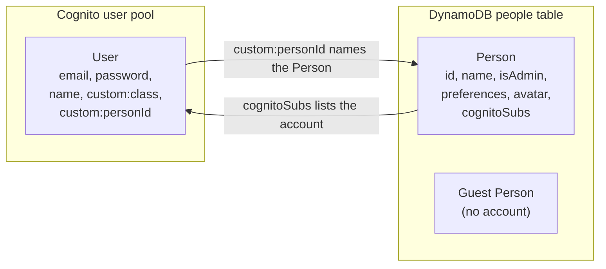
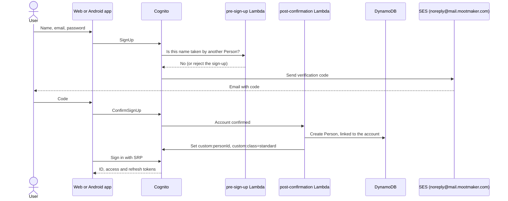

# Identity and access

Who can sign in, how, what proves who they are on each request, and what each kind of caller may do.
The wider security picture (AWS, GitHub, secrets) is in [security](security.md).

## Accounts and people

Mootmaker keeps two records for a user, and the difference matters:

- **A Cognito user** is an account: an email address and a password. It exists to sign in.
- **A Person** is someone who can organise or attend meetings. It holds the real display name,
  preferences and avatar.
- **Signing up creates both.** Once the email is confirmed, a Cognito trigger creates the Person,
  writes its id onto the account as `custom:personId`, and sets `custom:class` to `standard`.
- **A Person can exist without an account.** Admins add guests (a visitor, a contractor) so they
  can be booked into meetings.
- **An account can exist without a Person**, if the trigger failed. The apps handle it (the
  calendar is disabled and the home page explains), and `database-repair` creates the missing
  Person. See the [missing profile runbook](../runbooks/account-has-no-profile.md).

## Signing up and signing in

- **Passwords**: at least 10 characters, with a lowercase letter and a number. Deliberately loose,
  because the public demo account's password must be easy to type. No MFA.
- **SRP sign-in.** Both apps prove they know the password without sending it (Cognito's Secure Remote
  Password flow). The web app uses `amazon-cognito-identity-js`; the Android app has its own SRP
  implementation, tested against values from the same library.
- **Names are unique.** The pre-sign-up trigger refuses a sign-up whose name matches an existing
  Person, ignoring case and spaces, because people are picked by name throughout the app.
- **The post-confirmation trigger never fails the sign-up.** If creating the Person fails, it logs
  the error and the account exists without a Person, rather than leaving the user unable to finish.
- **Forgotten passwords** are reset with an emailed code. Cognito answers the same way whether or not
  the email has an account, so the form cannot be used to find out who has signed up.
- **Verification and reset emails** come from `noreply@mail.mootmaker.com`, sent by SES, not by
  Cognito's built-in mailer (which has a low daily cap shared across the account).

## Tokens

| Token | Lifetime | Used for |
|---|---|---|
| ID token | 1 hour | Sent with every GraphQL request. Carries the claims the API checks: `sub`, `email`, `name`, `custom:class`, `custom:personId` |
| Access token | 1 hour | Not used by the apps |
| Refresh token | 30 days | Gets a new ID token silently when the old one expires |

Where they are kept:

- **Web**: in the browser's `localStorage`, by `amazon-cognito-identity-js`. A session survives a page
  reload and lasts until the refresh token expires or the user signs out.
- **Android**: encrypted with AES-GCM under a key held in the Android Keystore, so a copy of the app's
  data directory cannot reveal them.

A token's claims are fixed when it is issued. **A change to someone's role reaches their token at the
next refresh**, so within the hour.

## Roles and what they allow

Every account has a `custom:class` of `standard` or `admin`. Only the API can change it (the app
clients are not allowed to write that attribute), through `setPersonAdmin`, which also copies it to
the Person's `isAdmin` so the admin screens can show it. The token claim is what is checked; the
Person's copy is display only.

| Caller | How it proves itself | Can do |
|---|---|---|
| Anyone | Nothing | Load the site; see the demo login on the home page |
| Standard user | ID token, `custom:class=standard` | Read everything; book meetings; edit or cancel meetings they organise; respond to their own invitations; change their own name, preferences and avatar; delete their own account |
| Admin | ID token, `custom:class=admin` | Everything a standard user can, plus: create, edit and delete rooms and people; grant and revoke admin; edit or cancel any meeting; set anyone's avatar |
| Machine client (tests, demo-data) | Access token from the OAuth2 client-credentials flow, scopes `execute` and `admin` | What an admin can do, with no user behind it |
| The resolver Lambda itself | IAM signature | Only `publishDaysInvalidated`, the broadcast |

**Enforcement is server-side, in two layers.** AppSync rejects any request without a valid token
before code runs. Then each handler checks the caller in Java (`Identity.requireAuthenticated`,
`requireAdmin`, `requireAdminOrSelf`) before doing anything. The apps hide admin controls from
standard users, but that is presentation only; the server refuses regardless.

**Self-only operations have no admin override.** `updateMyName`, `updateMyPreferences`,
`respondToMeeting` and `deleteMyAccount` always act on the caller's own Person, found from the
`custom:personId` claim. Nobody can set another person's preferences or answer for them.

**Some refusals are fixed rules**, whoever asks: an admin cannot revoke their own admin access, delete
their own Person (they use Delete account instead), or delete a reserved account.

## The Cognito app clients

| Client | Kind | Used by |
|---|---|---|
| `<env>-mootmaker-webapp` | Public, SRP and refresh only | The web app |
| `<env>-mootmaker-android` | Public, SRP and refresh only | The Android app. Separate from the web app's so it can be revoked or tuned alone |
| `<env>-mootmaker-acceptance-tests` | Confidential, client credentials, 4-hour tokens | API and web acceptance tests, the release smoke tests, the web app's pre-deploy schema check |
| `<env>-mootmaker-demo-data` | Confidential, client credentials | mootmaker-demo-data, which reads its secret from SSM at run time |

The two machine clients' secrets are generated by Terraform and stored as SSM `SecureString`
parameters; they never appear in a repository.

## Special accounts

| Account | Exists in | What it is |
|---|---|---|
| `demo@mootmaker.com` | Every environment | The public demo account, **an admin**. Its password is random lowercase letters and digits, generated at deploy time and shown on the home page. Anyone can sign in as it, so anyone can use admin features in the demo |
| `e2e-admin-user@mail.mootmaker.com` | Ephemeral only | Admin fixture for test suites |
| `e2e-standard-user@mail.mootmaker.com` | Ephemeral only | Standard fixture for test suites |
| `e2e-no-person-user@mail.mootmaker.com` | Ephemeral only | Deliberately has no Person, to test that path |

These are **reserved**: they cannot delete themselves, admins cannot delete their Person, and
`database-reset` keeps them. Reset also puts each fixture user back exactly as described, undoing
anything a test changed. Their passwords are in SSM under
`/mootmaker/<env>/api/`.

## Deleting an account

Delete account (Settings, on both apps) cancels the meetings the user organises from now on, removes
them from meetings they attend, deletes their avatar and their Person, and then deletes the Cognito
user. It cannot be undone. An admin deleting someone else's Person (`deletePerson`) does the same,
including deleting every account linked to that Person.

## What is not supported

- **No MFA**, and **no sign-in with Google** or any other identity provider. A design for Google
  sign-in exists ([google-sign-in.md](../../designs/google-sign-in.md)) but has not been built. The
  post-confirmation trigger only fires for native sign-up, so federated sign-in would need its own way
  to create the Person.
- **No "sign out everywhere".** Signing out ends the session on that device (the Android app also
  revokes its refresh token with Cognito). An ID token already issued stays valid until it expires,
  up to an hour.
