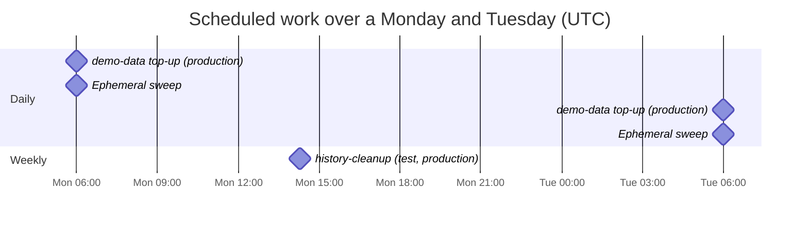

# Operations

Keeping Mootmaker running: what watches it, where its logs are, the routine checks worth doing, and
what runs on its own. When something is actually wrong, start from the [runbooks](../runbooks/README.md).

## What watches the system

| Watcher | Checks | Tells you by |
|---|---|---|
| The release pipeline | Smoke tests on `test` and `production`, around every release | A red run and a `FAILED` prerelease; rollback in `production` |
| Daily sweep (`sweep.yml`, 06:00 UTC) | Forgotten ephemeral environments; orphaned log groups; `check-accumulation.sh` | A red workflow run; GitHub emails the failure |
| AWS Budgets | Monthly cost against US$1 and US$10 | Email to Geoff |
| Android pull-request checks | A read-only demo sign-in against `production` on every push | A red check |

**Nothing watches `production` between releases.** There are no CloudWatch alarms and no uptime
checks, so an outage is found by whoever next opens the site, or by the next Android push or release.
A quick manual check is in the [site is down runbook](../runbooks/site-is-down.md). Options for a
scheduled check are in [mootmaker-release#92](https://github.com/geoffweatherall/mootmaker-release/issues/92).

## Where the logs are

All logs are in CloudWatch in the workload account, `us-east-1`, and every log group has a retention
period.

| Log group | Contains | Kept |
|---|---|---|
| `/aws/lambda/<env>-mootmaker-resolvers` | Every API request's handler output and errors, and `REPORT` lines with duration | 120 days |
| `/aws/lambda/<env>-mootmaker-post-confirmation-create-person` | Person creation at sign-up, including any swallowed failure | 120 days |
| `/aws/lambda/<env>-mootmaker-pre-sign-up-name-collision` | Sign-ups refused for a taken name | 120 days |
| `/aws/lambda/<env>-mootmaker-database-reset`, `-database-repair`, `-history-cleanup` | What each run deleted, repaired or moved | 120 days |
| `/aws/lambda/<env>-mootmaker-demo-data` | What each demo-data run created or skipped | 120 days |
| `/aws/appsync/apis/<api-id>` | AppSync errors only (field log level `ERROR`): failures before or outside a resolver | 120 days |
| `/mootmaker/release-pipeline` | Every release stage's output, one stream per stage, keyed by version | 120 days |
| `/aws/route53/mootmaker.com` | Every DNS query for the zone | 14 days |

The quickest way in:

```bash
aws logs tail /aws/lambda/production-mootmaker-resolvers --since 1h --follow
aws logs tail /aws/lambda/production-mootmaker-resolvers --since 1d --filter-pattern ERROR
```

### Release pipeline logs

Each release stage writes structured lines (version, stage, component, environment, outcome) to
`/mootmaker/release-pipeline`, including stages that failed. Two saved Logs Insights queries read them
back: **"mootmaker/release - everything for one version"** and **"mootmaker/release - failures across
all releases"**. The GitHub Actions run itself keeps fuller logs for 90 days. See the
[failed release runbook](../runbooks/failed-release.md).

## What runs on its own



| Job | When | If it fails |
|---|---|---|
| demo-data top-up | Daily 06:00 UTC, `production` | The demo slowly runs out of future meetings. See [demo data missing](../runbooks/demo-data-missing.md) |
| Ephemeral sweep | Daily 06:00 UTC | Forgotten environments keep costing a little, and the accumulation check does not run |
| history-cleanup | Mondays 14:17 UTC, `test` and `production` | Old days are not deleted. `check-accumulation.sh` notices when the boundary stops advancing |
| IAM key-rotation enforcer | Daily | Nothing visible; there are no IAM keys |

## Routine checks

Worth doing now and then, and after anything unusual:

| Check | How | Expect |
|---|---|---|
| Is production up? | `curl -s -o /dev/null -w '%{http_code}\n' https://www.mootmaker.com` and sign in with the demo login | `200`, and a populated home page |
| Anything left behind? | `mootmaker-bootstrap-aws-accounts/list-unmanaged-resources.sh` | `Nothing needs attention` |
| Anything growing? | `mootmaker-bootstrap-aws-accounts/check-accumulation.sh` | Exit 0 |
| Ephemeral environments | `mootmaker-ephemeral-envs/list-ephemeral-envs.sh` | Only ones in use, or kept with a reason |
| The bill | Cost Explorer, by service, for this month and last two | Flat, apart from release activity. See [cost](cost-and-scale-to-zero.md) |
| Long-lived credentials | `aws iam list-users`; GitHub secrets in mootmaker-release | No IAM users; only the documented secrets |
| Open issues labelled `bug` | Across all repositories | Nothing that affects `production` and is not already being worked on |

## Admin tools

`database-reset` and `database-repair` (in each environment) are the operational tools for data. Both
are invoked directly with AWS credentials; see [data](data.md#resetting-and-repairing-an-environment).
`production`'s reset never touches Cognito, but it does delete every room and meeting, so the demo is
empty until demo-data runs again.

## Changing test and production

Only through a release. Hand deploys are for recovering a broken pipeline; see
[delivery](delivery.md). If a hand deploy is ever made, say so in an issue, and follow it with a normal
release so `production` again runs something a release can name.
