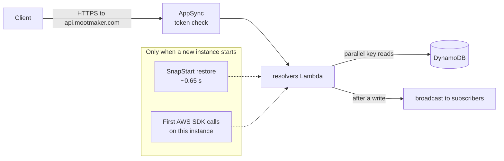

# Performance

How fast Mootmaker is, what makes it slow when it is slow, and the choices that keep it quick on a
system that scales to zero.

## How fast it is

Production, over the seven days to 2026-10-12:

| Request | p50 | p90 |
|---|---|---|
| A request to a warm Lambda | 340 ms | 660 ms |
| A request that starts a new Lambda instance (restore plus first request) | 2.6 s | 3.2 s |

About one request in five started a new instance, because demo traffic is light and instances are
recycled when idle. Add a few tens of milliseconds for AppSync and the network. The cold figure is
higher than the API's own measurements of its start-up tuning; see
[mootmaker-api#114](https://github.com/geoffweatherall/mootmaker-api/issues/114).

To measure it again, read the `REPORT` lines in `/aws/lambda/production-mootmaker-resolvers`; see
the [slow app runbook](../runbooks/app-is-slow.md).

## Where the time goes in a request

## Starting a Java Lambda quickly

Java is slow to start: a JVM has to boot, and the first call to any AWS service loads and interprets a
large amount of SDK code. Without mitigation a cold request took over four seconds. Three things bring
it down:

1. **SnapStart.** Lambda takes a snapshot of the initialised function when a version is published and
   restores it for each new instance, instead of booting the JVM again. The `live` alias, which
   AppSync calls, always points at a published version.
2. **Priming before the snapshot.** Every handler is constructed during initialisation, and the SDK
   clients make throwaway calls before the snapshot is taken, so the classes those calls need are
   loaded already in the snapshot. After a restore, connections are re-established before the first
   real request. `impl/java-lambda-cold-start-mitigation.md` in mootmaker-api explains why both steps
   are needed.
3. **One function for every field.** A single `resolvers` Lambda serves the whole API and routes on
   the GraphQL field name. A user moving between screens reuses one warm instance instead of starting
   one per field, and one snapshot holds every handler.

Also: the deployable jar excludes HTTP clients and logging frameworks it does not use, since every
class in it is a candidate for loading; and Java 25 lets SnapStart functions use the full JIT
compiler.

Cognito's trigger Lambdas use SnapStart too, since a slow sign-up confirmation is visible to the user.

## Doing less per request

- **One request per screen.** `workspace(dates: [...])` returns the caller, rooms, people and the
  requested days together, so a screen needs one round trip.
- **Only what was selected is fetched.** A resolver looks at the requested fields and skips reads
  nobody asked for: `workspace { rooms { id } }` does no people or day lookups.
- **Days are read by key, in parallel**, with consistent reads. No scans of meetings, no indexes.
- **Clients cache what they have seen** and keep it on screen while refetching, so going back to a
  screen is instant. See [concurrent updates](concurrent-updates.md).
- **Static content and avatars come from CloudFront.** Avatar URLs include a hash of the image and
  are cached for a year.

## Bounds that keep the worst case bounded

Every request has a ceiling, so no input can make the API do unbounded work or return an unbounded
response: at most 42 dates per request, 2,000 meetings per response, 320 meetings per day, 200 rooms
and 1,000 people. See [data](data.md#limits).

## Timeouts

| Function | Timeout | Why |
|---|---|---|
| `resolvers`, Cognito triggers | 15 s | A user is waiting |
| `history-cleanup` | 300 s | Its work is bounded by the size of the window |
| `database-reset`, `database-repair`, `demo-data` | 900 s | Work grows with stored data. Invoke them with `--cli-read-timeout 900`, or the AWS CLI gives up after 60 s while the function carries on |

## Not measured

There are no load tests. Nothing here says how the system behaves with hundreds of simultaneous users.
The likely first limits would be contention on a single popular day (each write to a day retries up to
five times), the account's Lambda concurrency (1,000), and AppSync's per-account request rate.
