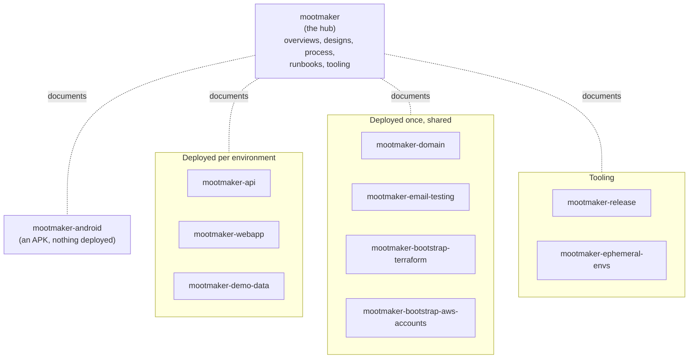
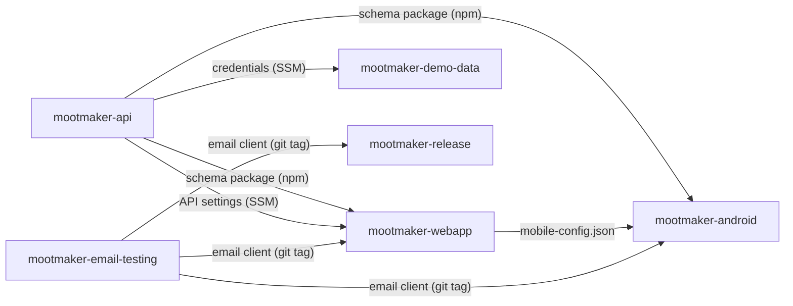
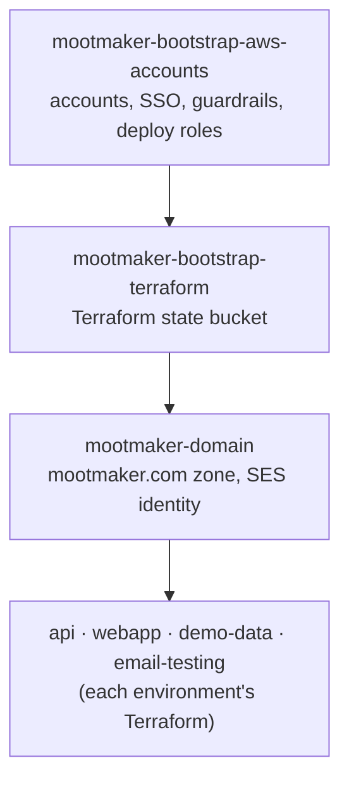

# Repositories

Mootmaker is split across several GitHub repositories, all named `mootmaker-*` and all public. This
page explains the split: what each repository owns, how they depend on each other, and the
conventions they share.

## The hub and the components



**`mootmaker` is the hub.** It holds no deployed code and appears in no build. It is the landing
page for the project and holds what spans repositories: these overviews, the
[runbooks](../runbooks/README.md), the [designs](../../designs/), the [process](../process/README.md)
and the cross-client [use cases](../reference/use-cases.md). Every other repository describes
itself in its own README and points back here for the bigger picture.

| Repository | Owns | Deployed |
|---|---|---|
| [mootmaker-api](https://github.com/geoffweatherall/mootmaker-api) | The GraphQL schema, the Java Lambdas, DynamoDB, Cognito, avatars storage and CDN, the reset/repair/cleanup Lambdas | Per environment |
| [mootmaker-webapp](https://github.com/geoffweatherall/mootmaker-webapp) | The React app, its S3 bucket and CloudFront distribution, `env-config.js` and `mobile-config.json` | Per environment |
| [mootmaker-demo-data](https://github.com/geoffweatherall/mootmaker-demo-data) | The Lambda that generates demo people, rooms, meetings and avatars | Per environment; always in `production` and `test`, optional elsewhere |
| [mootmaker-android](https://github.com/geoffweatherall/mootmaker-android) | The Android app | Nothing to deploy. Each release attaches a signed APK |
| [mootmaker-release](https://github.com/geoffweatherall/mootmaker-release) | The release pipeline, the release smoke tests, release log shipping, the fail-fast action | GitHub Actions only |
| [mootmaker-ephemeral-envs](https://github.com/geoffweatherall/mootmaker-ephemeral-envs) | Scripts to create, list, keep and tear down ephemeral environments; the daily sweep | GitHub Actions only |
| [mootmaker-email-testing](https://github.com/geoffweatherall/mootmaker-email-testing) | The SES → SNS → SQS pipeline that lets tests read real email, and the client package tests use to read it | Once |
| [mootmaker-domain](https://github.com/geoffweatherall/mootmaker-domain) | The `mootmaker.com` hosted zone, DNS query logging, the apex redirect, the SES identity for `mail.mootmaker.com` | Once |
| [mootmaker-bootstrap-terraform](https://github.com/geoffweatherall/mootmaker-bootstrap-terraform) | The S3 bucket holding every Terraform state file | Once per AWS account |
| [mootmaker-bootstrap-aws-accounts](https://github.com/geoffweatherall/mootmaker-bootstrap-aws-accounts) | CloudFormation for both AWS accounts: SCPs, SSO, budgets, the GitHub Actions deploy roles; account-wide check scripts | Once per account, by hand |

**Why several repositories rather than one.** Each deployable part builds, tests, versions and
deploys on its own, with its own pull-request checks and its own Terraform state. The cost is that a
change spanning repositories becomes several pull requests, merged in dependency order; see
[branching and PRs](../process/branching-and-prs.md#cross-repo-changes).

## How the repositories depend on each other

No repository reads another's Terraform state. They find each other in four ways, all keyed on a
name rather than on anything stored by the other side:

What the code repositories share:



What all the infrastructure stands on:



| Mechanism | Used for |
|---|---|
| **Published packages** | `mootmaker-api` publishes its schema as `@mootmaker/schema` on npmjs.com whenever it changes on `main`. The web app and the Android app generate their code from it at a pinned version. (It is also published to GitHub Packages as `com.mootmaker:mootmaker-schema`; nothing consumes that copy yet.) The email-testing client is installed straight from a git tag. See [API contract](api-contract.md). |
| **SSM Parameter Store** | Each deploy publishes what others need under `/mootmaker/<environment>/<component>/`. The web app's deploy reads the API's URL and Cognito ids from there; demo-data reads its own credentials at run time; test runners read fixture users and function names. |
| **AWS lookups by name** | Terraform finds the hosted zone (`mootmaker.com.`) and the SES identity (`mail.mootmaker.com`) with `data` sources, so mootmaker-domain need not export anything. |
| **Reusable workflows** | mootmaker-release calls each component's `release-build.yml`, so each component owns its own build and deploy logic. |

The deploy order follows from this. For a new environment: **api, then webapp, then demo-data**. For a
brand-new AWS account: bootstrap-terraform and bootstrap-aws-accounts first, then domain (and wait for
the registrar's nameserver delegation), then email-testing, then any environment.

## Shared conventions

**Sibling checkouts.** Every repository expects the others checked out side by side in one
directory. Scripts use paths like `../mootmaker-api`, and the hub's tooling walks `..` to find every
checkout. See [getting started](../development/getting-started.md).

```
mootmaker-workspace/
  mootmaker/  mootmaker-api/  mootmaker-webapp/  mootmaker-android/  mootmaker-demo-data/
  mootmaker-release/  mootmaker-ephemeral-envs/  mootmaker-email-testing/  mootmaker-domain/
  mootmaker-bootstrap-terraform/  mootmaker-bootstrap-aws-accounts/
```

**The same files in every repository.**

| File | Purpose |
|---|---|
| `README.md` | What the repository is, how it fits, how to build, test and deploy it. The first thing to read |
| `AGENTS.md` | Rules for anyone (person or AI agent) changing the repository. `CLAUDE.md` is a symlink to it, so every tool reads the same file |
| `testing-strategy.md` | The repository's test layers, where it has tests |
| `deploy.sh` / `undeploy.sh` | For anything with infrastructure. Per-environment components take the environment name as the first argument; shared ones take none |

**One Terraform state key per component per environment**: `<environment>/<repository>/terraform.tfstate`
in the shared state bucket. Listing the bucket is how the ephemeral-environment scripts discover what
exists.

**Every resource name starts with the environment**: `<environment>-mootmaker-...`, for example
`production-mootmaker-resolvers`. That is what lets many environments share one account, and what
the IAM policies and the GitHub deploy roles match on.

**`main` is always deployable, and work lands by pull request.** Tags (`vX.Y.Z`) are pushed only by
the release pipeline, to every component it released and to mootmaker-release itself. See
[GitHub](github.md).
