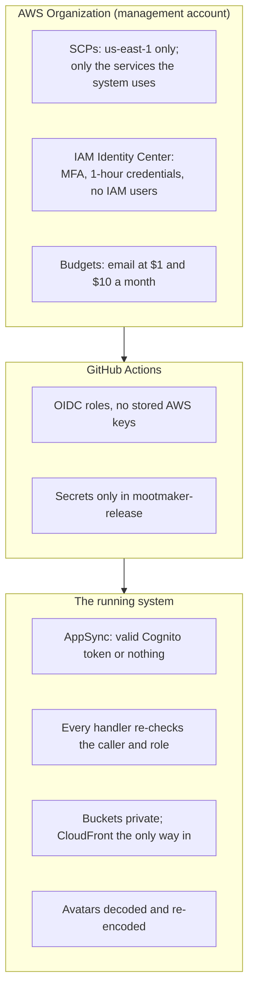

# Security

What protects Mootmaker, layer by layer, and where the known gaps are. Sign-in and roles inside the
app are covered in [identity and access](identity-and-access.md); this page covers the rest.

## What is being protected

Mootmaker is a public demo, so the usual priorities shift. Its data is disposable, the demo
account's password is published, and anyone can use admin features in the demo. What actually
matters:

| Asset | Why it matters |
|---|---|
| **The AWS account** | Anyone who can run things in it can run up a bill or misuse it. Cost is the realistic harm |
| **Push access to GitHub** | Code on `main` in some repositories can deploy to `production` |
| **The Android signing key** | Installed apps only accept updates signed with the same key. Losing it strands every installed copy; leaking it lets someone else ship "updates" |
| **Real visitors' details** | Anyone may sign up. The system holds their email, name and any avatar |
| **The public demo staying up** | It is the project's front door |

## The layers

### The AWS accounts

Two accounts in one AWS Organization: a **management** account that holds no workloads, and a
**workload** account that holds every environment. See [AWS accounts](aws-accounts.md) for the full
setup.

- **Service control policies** in the management account limit the workload account to `us-east-1`
  and to the services the system uses (Lambda, DynamoDB, AppSync, Cognito, S3, CloudFront, SES, and
  the rest; no EC2). A leaked credential cannot start a mining fleet, or anything in another region.
  The workload account's own administrators cannot remove them.
- **Nobody has long-lived AWS credentials.** There are no IAM users. People sign in through IAM
  Identity Center with MFA and get one-hour credentials. A scheduled Lambda deactivates any IAM access
  key older than 90 days, as a backstop in case one is ever created.
- **The management account is harder to reach than the workload account.** Changing its stacks
  needs a separate Identity Center user and a deliberate sign-in that yields one hour of credentials.
  Changing who can access it needs the root user.
- **Budgets email Geoff** when the month's actual or forecast cost passes $1 and $10 in the workload
  account, and when anything at all is spent in the management account.

### GitHub and AWS

GitHub Actions reaches AWS only through OIDC: a workflow exchanges a short-lived GitHub token for one
hour of credentials on a role. The roles trust a repository and a ref, not a workflow file, because
AWS cannot check which workflow file asked.

| Role | Trusted | Can |
|---|---|---|
| `mootmaker-release-github-actions-deploy` | mootmaker-release and mootmaker-ephemeral-envs at `main`; the component repositories at `v*` tags | Deploy and destroy any environment, including `test` and `production` |
| `mootmaker-ephemeral-github-actions-deploy` | `pull_request` runs in mootmaker-android and mootmaker-webapp; mootmaker-ephemeral-envs at `main` | Deploy ephemeral environments. Explicitly denied `test` and `production`'s state, resources, parameters and DNS |

Both roles' permissions are scoped to resources named `*-mootmaker-*` wherever AWS allows it. AppSync,
Cognito, ACM and CloudFront only get ids when created, so creating them cannot be scoped by name,
which also means the ephemeral role's denials cannot cover those four services by name. The
denials guard against mistakes, not against someone deliberately misusing push access.

**Nothing reaches a trusted `main` by direct push.** mootmaker-release and mootmaker-ephemeral-envs
require a pull request to change `main`, for admins too, so a leaked token with push access cannot
quietly change what the release role runs. Tags in the component repositories are pushed only by the
release's `tag` job. See [GitHub](github.md#branch-protection).

**Pull requests from forks get no AWS access.** GitHub gives a fork's pull-request run neither
secrets nor an OIDC token, and first-time contributors' runs need approval.

**Secrets.** Only mootmaker-release holds any: the fine-grained token that pushes release tags, and
the Android signing key's four parts. Every repository's default workflow token is read-only. The
signing key is generated and backed up offline and never enters a cloud AI session.

**Packages.** The schema is published to npm by trusted publishing (OIDC, with provenance), so there
is no npm token to steal.

### The running system

- **Every API call needs a valid Cognito token**, checked by AppSync before any code runs. There is
  no API key. Each handler checks the caller again, and checks the role for anything admin-only.
- **The broadcast field (`publishDaysInvalidated`) accepts only IAM**, and the resolver Lambda's IAM
  permission names that one field, so it cannot use IAM to call any other mutation and skip the role
  checks.
- **Lambda roles are scoped to one environment.** The three request-path Lambdas (resolvers and the
  two Cognito triggers) share a role limited to that environment's tables, avatars bucket, user pool
  and broadcast field. `database-reset`, `database-repair` and `history-cleanup` each have their own.
  The admin Lambdas are not reachable through the API at all; invoking them needs AWS credentials.
- **`production` refuses the destructive parts of reset.** Its Cognito wipe is turned off by a
  Terraform setting, not a runtime flag.
- **Buckets are private.** The site and avatar buckets block public access, and only their CloudFront
  distributions can read them (origin access control). Uploads go through presigned URLs that fix the
  content type and exact length.
- **Uploaded images are never served as uploaded.** The API decodes each one and writes a fresh
  256 × 256 JPEG, which strips metadata and anything hidden in the file, and checks dimensions before
  decoding so a tiny file cannot claim enough pixels to exhaust memory.
- **Configuration published to the clients is not secret.** The Cognito ids are public identifiers,
  and the demo login is meant to be shown. Machine-client secrets are SSM `SecureString` parameters,
  readable only by the components that need them.

### Workstations and AI sessions

- Local AWS access is SSO only; `~/.aws/credentials` stays empty. See
  [AWS accounts](aws-accounts.md#getting-access).
- Geoff's machine-local Claude Code settings deny commands that would print SSO role credentials or
  reach the management account's credentials helper. They are not versioned; the versioned
  [workspace settings](../development/workstation.md) hold only allow and ask rules.
- Cloud AI sessions have no AWS credentials. They get an environment by asking GitHub Actions to
  create one with the ephemeral role.
- Never put a credential in a Claude Code permission rule: approved commands are stored verbatim, and
  the workspace settings file is versioned in a public repository.

## Personal data

| Data | Where | Kept until |
|---|---|---|
| Email, name, password verifier | Cognito | The account is deleted |
| Name, preferences, linked emails | DynamoDB people table | The Person is deleted |
| Avatar | S3, served publicly by an unguessable URL | Replaced or the Person deleted. An edge-cached copy can outlive deletion briefly |
| Meetings someone is in | DynamoDB meetings table | Deleted, or removed by history cleanup after 30–37 days |
| Emails of accounts removed by a reset | CloudWatch logs (`database-reset`), outside `production` | 120 days |
| Request logs | CloudWatch: Lambda logs, AppSync errors only | 120 days |

Deleting an account removes everything in the first three rows. The
[privacy policy draft](../showcase/privacy-policy-draft.md) has not been published.

## Known gaps

| Gap | Risk | Tracked |
|---|---|---|
| The site sends no security headers (no CSP, no HSTS), and the web app keeps tokens in `localStorage` | Script injection would expose tokens. No known injection point | [mootmaker-webapp#170](https://github.com/geoffweatherall/mootmaker-webapp/issues/170) |
| The demo account is an admin, and its password is public | By design: the demo must show admin features. Anyone can change demo rooms and people | Accepted |
| Weak password policy, no MFA | By design, to keep the demo easy to try | Accepted |
| Sign-up says when an email already has an account, and the name check says when a name is taken | Lets someone test whether an address or name is registered | Accepted |
| Repository trust is by repository and ref, not workflow file | Any workflow on a trusted ref can deploy | AWS limitation; mitigated by the ref patterns |
| `RELEASE_TAG_PAT` is a long-lived token | If leaked, it could push to the released repositories | Fine-grained to `contents: write` on those repositories only |

To report a security problem, open an issue in the repository concerned, or contact Geoff directly
for anything that should not be public.
