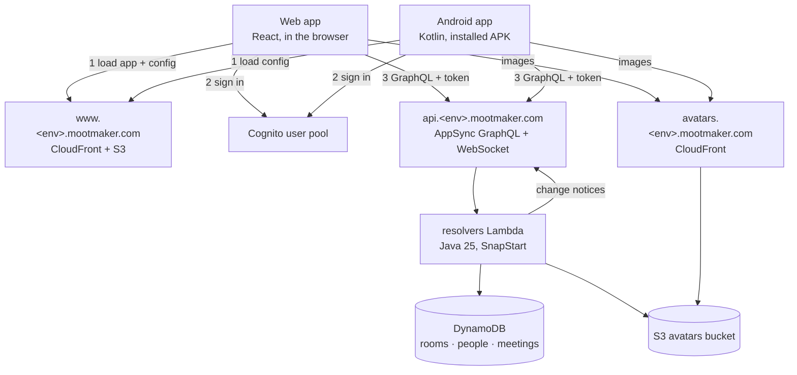
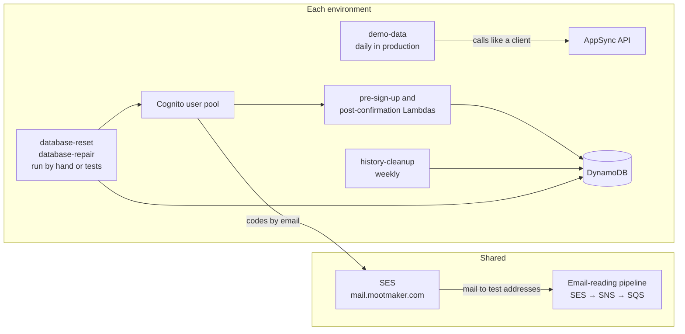
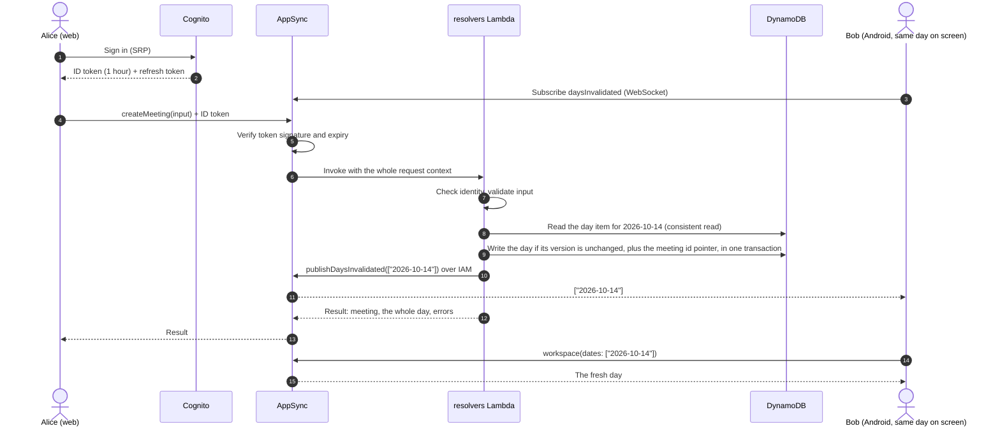
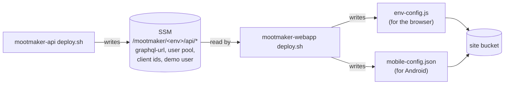

# The system

Mootmaker is a meeting-room booking system. People sign in, see their day, find a free room and
book a meeting with others. Admins manage the rooms and the people. A public demo runs at
[www.mootmaker.com](https://www.mootmaker.com), filled with generated demo data.

This page shows every running part, how a request moves through them, and which repository owns
each. Read it first; the other overviews go deeper into one topic each.

## The parts

And the parts that work behind the scenes, or are shared by every environment:

Every environment (`production`, `test`, or a short-lived ephemeral one) is a complete copy of the
per-environment parts, with its own hostnames. In `production` the `<env>.` segment is dropped:
`www.mootmaker.com`, `api.mootmaker.com`, `avatars.mootmaker.com`. The shared parts exist once.
[Delivery](delivery.md) covers how environments are created and changed.

| Part | What it does | Repository |
|---|---|---|
| Web app | Single-page React app, served as static files. Talks to Cognito and AppSync straight from the browser | [mootmaker-webapp](https://github.com/geoffweatherall/mootmaker-webapp) |
| Android app | Native app with the same features as the web app. Distributed as a signed APK on each [release](https://github.com/geoffweatherall/mootmaker-release/releases/latest) | [mootmaker-android](https://github.com/geoffweatherall/mootmaker-android) |
| AppSync | The GraphQL API. Checks every request's Cognito token before anything runs, and pushes change notices over a WebSocket | [mootmaker-api](https://github.com/geoffweatherall/mootmaker-api) |
| `resolvers` Lambda | One Java function behind every GraphQL field. Holds all the business rules | mootmaker-api |
| DynamoDB | Three on-demand tables. Meetings are stored one item per calendar day | mootmaker-api |
| Cognito | Accounts, passwords and tokens. Emails verification codes through SES | mootmaker-api |
| Avatars | Profile pictures: uploaded to S3 by presigned URL, re-encoded by the API, served from their own CDN | mootmaker-api |
| `history-cleanup` | Deletes meeting days older than the retention window, weekly (`test` and `production`) | mootmaker-api |
| `database-reset`, `database-repair` | Run by hand or by tests to wipe or fix an environment's data | mootmaker-api |
| `demo-data` | Keeps an environment populated with realistic people, rooms and meetings, by calling the API like any client | [mootmaker-demo-data](https://github.com/geoffweatherall/mootmaker-demo-data) |
| Route 53, SES identity, apex redirect | The `mootmaker.com` zone, sending and receiving mail on `mail.mootmaker.com`, and `mootmaker.com` → `www` | [mootmaker-domain](https://github.com/geoffweatherall/mootmaker-domain) |
| Email-reading pipeline | SES receipt rule → SNS → SQS, so tests can read real verification emails | [mootmaker-email-testing](https://github.com/geoffweatherall/mootmaker-email-testing) |
| Terraform state bucket | Holds every environment's state | [mootmaker-bootstrap-terraform](https://github.com/geoffweatherall/mootmaker-bootstrap-terraform) |
| Account guardrails | SCPs, SSO, budgets, the GitHub Actions deploy roles | [mootmaker-bootstrap-aws-accounts](https://github.com/geoffweatherall/mootmaker-bootstrap-aws-accounts) |

Everything runs in one AWS account, in `us-east-1`. Nothing runs when nobody is using it, which is
a deliberate constraint; see [cost and scale to zero](cost-and-scale-to-zero.md).

## What happens when someone books a meeting

The important points, each covered in more depth elsewhere:

- **The client never sends a password.** Both apps use Cognito's SRP flow and then send the ID token
  with every GraphQL call. See [identity and access](identity-and-access.md).
- **AppSync rejects unauthenticated calls before any code runs**, and every handler checks the
  caller again. Admin-only operations check the caller's role in Java.
- **A day is one DynamoDB item with a version number.** A write succeeds only if the version has
  not moved since the read, and retries if it has, so two people booking the same day cannot
  overwrite each other. See [data](data.md) and [concurrent updates](concurrent-updates.md).
- **Other screens are told which dates changed, never what changed.** They refetch those dates. The
  same message works for every kind of change and is never too big to send.
- **Validation failures are data, not errors.** A refused booking comes back as a normal result with
  a list of reasons (`TimeRangeUnavailable`, `InsufficientCapacity`, and so on), so a client can show
  them all at once.

## How the clients find the API

Neither app has an environment's addresses built in. When the web app is deployed, its deploy script
reads the API's published settings from SSM Parameter Store and writes two files next to the site:

- The browser loads `/env-config.js` before the app starts, so one built bundle can be deployed to
  any environment unchanged.
- The Android app fetches `https://www.<env>.mootmaker.com/mobile-config.json` and keeps the last good
  copy, so it can start without a network. The environment is `production` unless someone changes it
  on the About screen (tap the version seven times).

This is also why **mootmaker-api must be deployed before mootmaker-webapp** in a new environment, and
why an Android app pointed at an environment with no web app deployed cannot load its settings. Nothing here is
secret: the Cognito ids are public identifiers and the demo account is meant to be public.

## Background work

Two things run on a schedule, and two only when someone runs them:

| Job | When | What |
|---|---|---|
| `history-cleanup` | Mondays 14:17 UTC, in `test` and `production` | Deletes days before the retention boundary (30–37 days back) and moves the boundary forward |
| `demo-data` | Daily 06:00 UTC, in `production` | Tops up people, rooms and meetings to their targets. Never deletes anything |
| `database-reset` | By hand, or by test suites | Deletes all rooms and meetings, and (outside `production`) every non-reserved account |
| `database-repair` | By hand | Creates a missing Person for any confirmed account that has none |

Outside the running system, three things run on GitHub Actions: pull-request checks in each
repository, the release pipeline in mootmaker-release, and a daily sweep in mootmaker-ephemeral-envs
that destroys forgotten ephemeral environments and checks nothing is growing without a bound. See
[GitHub](github.md) and [delivery](delivery.md).

## Where to go next

| To understand | Read |
|---|---|
| Which repository holds what, and how they depend on each other | [Repositories](repositories.md) |
| How data is stored, kept and deleted | [Data](data.md) |
| How two people editing at once is handled, on web and Android | [Concurrent updates](concurrent-updates.md) |
| Sign-in, roles and what each kind of caller can do | [Identity and access](identity-and-access.md) |
| What protects the system | [Security](security.md) |
| How a change reaches production | [Delivery](delivery.md) |
| What it costs and why it idles at almost nothing | [Cost and scale to zero](cost-and-scale-to-zero.md) |
| What to do when something breaks | [Runbooks](../runbooks/README.md) |
