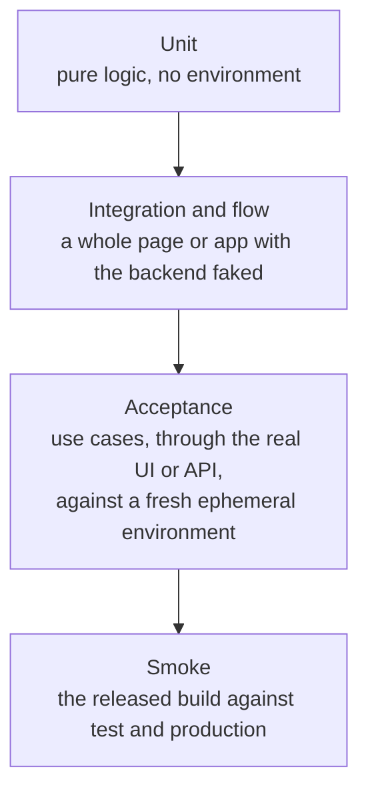
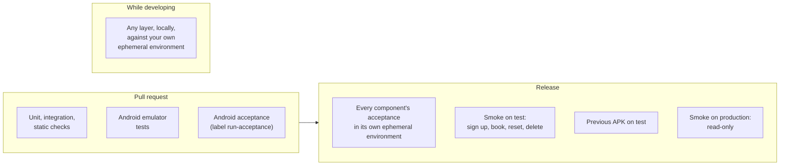
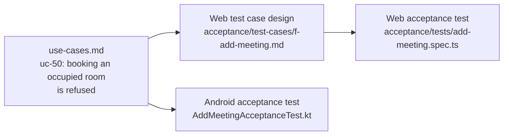

# Testing

How Mootmaker is tested across its repositories: the layers, what each is for, where each runs, and
how the tests trace back to what the system is supposed to do. Each repository's own
`testing-strategy.md` has the detail for that repository.

**The definition of working is a green acceptance run against a real deployed environment.** Not a
passing unit suite, not a successful deploy. Every other layer exists to fail sooner and more
cheaply.

## The layers



The question that decides a test's layer is **what does it need to be real to fail the way you are
worried about?** A date-formatting bug needs nothing real (unit). A page firing the wrong query needs
the page rendered (integration). A missing IAM permission, a Cognito trigger that does not fire or an
email that never arrives needs real AWS (acceptance).

| Layer | API | Web app | Android | demo-data | Runs |
|---|---|---|---|---|---|
| Unit | JUnit, `impl/src/test` | Vitest, `webapp/src/**/*.test.ts` | JUnit, `data/src/test` and ViewModels | JUnit | Every pull request |
| Integration / flow | Handlers with fake DynamoDB clients, within the unit suite | Playwright against an MSW-mocked API, `webapp/tests/` | Robolectric flow tests and Roborazzi screenshots, with `FakeBackend` | n/a | Every pull request |
| Instrumented | n/a | n/a | Emulator: real Keystore, app flow, and a read-only demo sign-in against `production` | n/a | Every push to android |
| Acceptance | JUnit over HTTP, `verify/` | Playwright, `acceptance/` | Compose UI tests on an emulator, `app/src/androidTest/.../acceptance/` | Invariants of generated data, `verify/` | Every release; android also on a labelled PR |
| Smoke | Web: Playwright in mootmaker-release `smoke/` | (same) | Maestro, `smoke/` | n/a | Every release, around each promotion |

Static checks run alongside: google-java-format, Checkstyle and compiler diagnostics for Java;
oxlint and TypeScript for the web app; Android lint; and the schema checks described in
[API contract](api-contract.md).

## Where each layer runs



The acceptance suites take several minutes each and cost a few cents in AWS, so they run once per
release rather than on every pull request. While developing, run them yourself against an ephemeral
environment:

```bash
mootmaker-api/verify.sh <env>              # API acceptance against an existing environment
mootmaker-webapp/acceptance/run.sh         # creates its own environment and tears it down
mootmaker-webapp/acceptance/run.sh <env>   # or reuses one
mootmaker-demo-data/verify.sh <env>
```

Android's emulator suites run only in GitHub Actions; label the pull request `run-acceptance`.

## Use cases: what the tests trace back to

[use-cases.md](../reference/use-cases.md) is the list of things the system must do, independent of
any client: about 140 numbered cases, grouped by area (sign-up, home page, add meeting, and so on).



- Each case is tagged **[All frontends]** or **[Webapp-specific]**. An [All frontends] case must hold
  on every client, in that client's own idiom.
- Each case links forward to the test that covers it on each client, or says why there is none.
- Each case has a stable anchor (`#uc-50`). **Do not renumber cases**; add new ones at the end of their
  section. Tests and test-case designs link to those anchors.
- A behaviour change starts by changing the use case, then the tests, then the code.

## Rules the suites follow

- **Each acceptance test makes what it needs** (rooms, people, meetings), with names unique to the
  run, and does not depend on another test or on demo data. Most start by calling `database-reset`.
- **Real email only where email is the point.** Sign-up and password reset read the real emailed
  code through the [email-reading pipeline](https://github.com/geoffweatherall/mootmaker-email-testing):
  each test sends to its own uniquely tagged address under `mail.mootmaker.com` and reads only its
  own messages from the shared SQS queue.
- **Fixture users** (an admin, a standard user, and one with no Person) exist only in ephemeral
  environments, and every reset restores them. Their credentials are in SSM.
- **The API's acceptance tests authenticate as a machine client** (OAuth2 client credentials), so they
  exercise the same token check as real users without a password in the pipeline.
- **"It's just flaky" is a hypothesis, not a conclusion.** Every intermittent failure in this project
  so far has turned out to be a real bug, in the product or in the test. Investigate before
  re-running; see the [flaky test runbook](../runbooks/flaky-test.md).
- **Assert what a user sees, not what is in the tree.** Android error displays are checked as
  displayed in the viewport; web avatar tests check the image actually loaded, because a broken image
  falls back to initials and looks like no avatar.
- **Smoke tests are deliberately small**: about five minutes of what a person would click through
  after a deploy. They are not a second acceptance run.

## Why the layers are shaped this way

Most of the code here is written by AI agents and gets a skim rather than a line-by-line review (see
[principles](../process/principles.md#how-much-human-review-the-code-actually-gets)). That changes what
the tests are for:

- **The tests do the job review used to do.** They are the check that the code does what was asked,
  so a behaviour change without a test change is treated as unfinished.
- **The fast layers are the ones an agent uses while working.** Unit and mocked integration tests run in
  seconds and cost nothing, so they run after nearly every change. The real-environment layers take
  minutes and a few cents, so they run once per piece of work. If the fast layers are thin, everything
  leans on the slow ones.
- **A flaky test is worse for an agent than for a person.** A person learns which red to ignore; an agent
  either chases a ghost or learns to ignore red. So real email and real AWS are kept to the layers whose
  job is proving them, and a flaky test is investigated rather than retried.

**Why tests read real email through one shared pipeline.** SES allows one active receipt rule set per
region, so a pipeline per environment would fight over which is active. One permanent rule set catches
everything under `mail.mootmaker.com`, and each test filters the queue for its own unique address. Tests
that only need a working account can skip email entirely with Cognito's admin APIs.

## Coverage gaps worth knowing

- **The API's acceptance tests use hand-written GraphQL strings** that nothing checks against the
  schema before they run, so a schema change can break them without any compile error. (demo-data's
  operations and the web acceptance suite's are checked.)
- **No automated accessibility checks** beyond Android's large-font screenshots and content
  descriptions.
- **No load or performance tests.** See [performance](performance.md).
