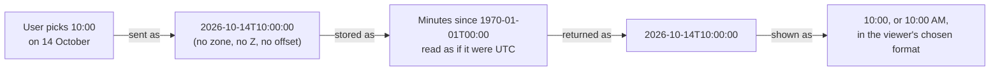

# Time and time zones

Dates and times are the most common source of subtle bugs in a booking system. This page states the
rules Mootmaker follows, so that new code follows them too.

## The model: one office, local time

Mootmaker models a single office. A meeting at `2026-10-14T10:00:00` means **10:00 on 14 October in
the office**, whatever time zone a viewer is in. Times carry no zone and no offset, and nothing
converts them.

The rules:

1. **On the wire, a time is always `yyyy-MM-ddTHH:mm:ss` with no zone.** Every GraphQL field and
   argument, in both directions.
2. **Never parse it as an instant.** In TypeScript, never `new Date(str)`; JavaScript would read it
   as the browser's local time and a later `toISOString()` would shift it. Use the helpers in the web
   app's `formatDateTime.ts`, which split the string rather than convert it. In Kotlin, parse with
   `LocalDateTime`, never `Instant` or `ZonedDateTime`. In Java, `LocalDateTime`.
3. **Storage is an implementation detail.** The API stores minutes since the epoch, computed as if the
   local time were UTC, purely because a number is smaller than a string. It converts back to exactly
   the same string. Nothing reads the number as a real instant.
4. **Times are on the quarter hour.** Starts and ends must be at :00, :15, :30 or :45, and the API
   refuses anything else. The Android time picker only offers those minutes.
5. **A meeting fits within one calendar date.** It cannot cross midnight.
6. **Business hours are 08:00 to 17:00.** Room availability shows that window, and demo-data books
   meetings in it. Meetings may still be booked outside it.

## Display preferences

Each person chooses how dates and times are *shown*:

| Preference | Options | Default |
|---|---|---|
| Date format | ISO `2026-10-14`, British `14/10/2026`, US `10/14/2026` | ISO |
| Time format | 24-hour `14:30`, 12-hour `02:30 PM` | 24-hour |
| Week starts on | Monday, Sunday | Monday |

These change only how a client renders and parses what a person types. The API speaks the same ISO
format to everyone and never branches on them. A wrong preference can show the right time written
the wrong way; it can never change stored data.

## Whose "today"?

Two clocks are involved, and they disagree for part of every day:

| Who | Uses | For |
|---|---|---|
| The web and Android apps | The device's local date and time | Which day the screen opens on, the default start time of a new meeting, "Today" and "Tomorrow" |
| The API and scheduled jobs | **UTC** (Lambda's clock) | The booking window and retention boundary; whether a meeting is "upcoming"; demo-data's "today" |

**The booking window is safe** because the server owns it. It sends the earliest and latest
allowed dates to the apps (`workspace { boundaries }`), which never compute them. A phone with a wrong
clock, or in a far time zone, cannot ask for a day the server has deleted, and the window is wide
enough (30+ days back, 180 ahead) that a few hours either way never matter.

**"Upcoming" is not quite right away from UTC.** Deleting an account or a person cancels their
*upcoming* meetings, and a room cannot be deleted while it has an *upcoming* meeting. "Upcoming" means
"starts at or after the current UTC time, read as a local time". In New Zealand (UTC+13), a meeting
that ended at 10:00 local time still counts as upcoming until 10:00 UTC, which is 23:00 local. So
deleting an account there can remove meetings from earlier the same day. This is tracked as
[mootmaker-api#113](https://github.com/geoffweatherall/mootmaker-api/issues/113), with a proposal to
give each environment a configured office time zone.

**Daylight saving is not modelled.** A meeting is a wall-clock time, so a change of clocks does not
move it, which is what people expect of a meeting room. Nothing in the system needs the real elapsed
duration across a clock change.

## Schedules are in UTC

Everything scheduled runs on UTC cron expressions. For reference, New Zealand is UTC+13 in summer
(late September to early April) and UTC+12 in winter.

| Job | UTC | New Zealand (summer / winter) |
|---|---|---|
| demo-data top-up (`production`) | Daily 06:00 | 19:00 / 18:00 |
| Ephemeral sweep | Daily 06:00 | 19:00 / 18:00 |
| history-cleanup (`test`, `production`) | Monday 14:17 | Tuesday 03:17 / 02:17 |

Report times to people in New Zealand time, converted from UTC.
