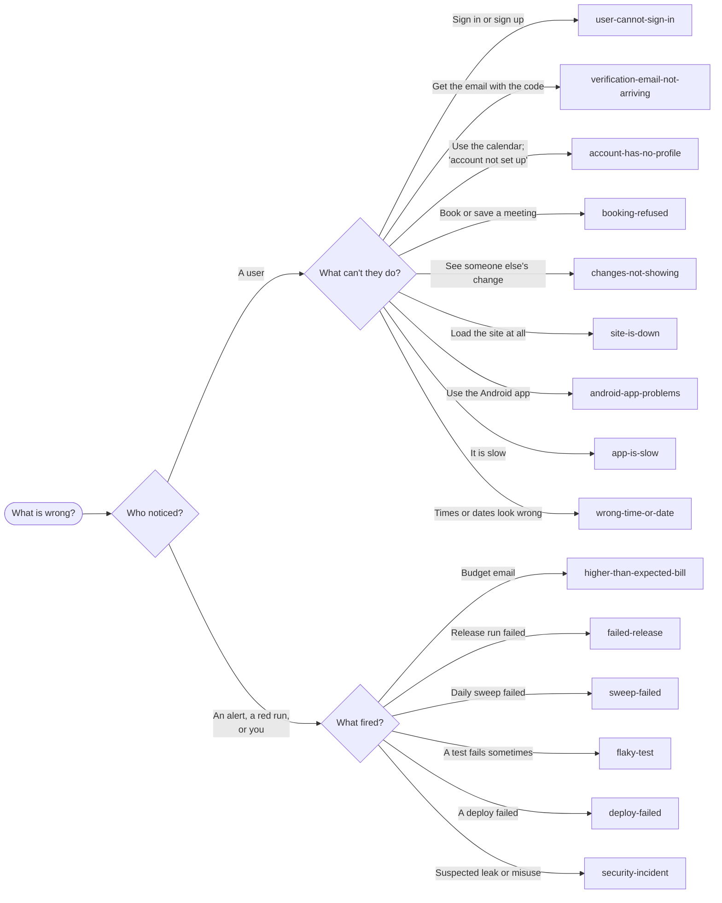

# Runbooks

What to do when something is wrong. Each runbook starts from a symptom someone reports or sees, gives
the checks to run in order, and says how to fix each cause it finds. They assume a terminal with the
workspace checked out and AWS access through SSO (`aws sso login`); see
[AWS accounts](../overview/aws-accounts.md#getting-access).

## Start here



## By symptom

### Users

| Runbook | When |
|---|---|
| [User cannot sign in](user-cannot-sign-in.md) | Wrong password, unconfirmed account, locked out, sign-up refused |
| [Verification email not arriving](verification-email-not-arriving.md) | No sign-up or password-reset code |
| [Account has no profile](account-has-no-profile.md) | "Your account hasn't been set up properly"; Calendar disabled |
| [Booking refused](booking-refused.md) | A meeting will not save, and the message is not clear enough |
| [Changes not showing](changes-not-showing.md) | One person's change does not appear for another |
| [Site is down](site-is-down.md) | The web app or the API does not respond |
| [Android app problems](android-app-problems.md) | Cannot install, cannot load, errors after an update, wrong environment |
| [App is slow](app-is-slow.md) | Long spinners, slow first load |
| [Wrong time or date](wrong-time-or-date.md) | A meeting at an unexpected time, "today" is the wrong day |
| [Avatar not showing](avatar-not-showing.md) | Initials where a photo should be, or an old photo |
| [Admin access](admin-access.md) | Granting or removing admin, or a change that has not taken effect |

### The demo and its data

| Runbook | When |
|---|---|
| [Demo data missing or wrong](demo-data-missing.md) | Empty calendar, no future meetings, vandalised demo |
| [Reset an environment](reset-an-environment.md) | Starting an environment's data again from scratch |

### Building and releasing

| Runbook | When |
|---|---|
| [Failed release](failed-release.md) | `release.yml` went red, rolled back, or left `test` broken |
| [Deploy failed](deploy-failed.md) | `deploy.sh` or a release's deploy stage failed |
| [Flaky test](flaky-test.md) | A test passes and fails on the same code |
| [Ephemeral environment problems](ephemeral-environment-problems.md) | Cannot create or tear down one; one is left over |

### Running it

| Runbook | When |
|---|---|
| [Higher-than-expected bill](higher-than-expected-bill.md) | A budget email, or a bill that has grown |
| [Sweep failed](sweep-failed.md) | The daily `sweep.yml` run is red |
| [AWS access problems](aws-access-problems.md) | `ExpiredToken`, `AccessDenied`, the wrong account |
| [Expired or lost credentials](expired-or-lost-credentials.md) | The release tag token expired; the Android signing key is lost |
| [Security incident](security-incident.md) | A leaked credential, unknown resources, misuse |

## Values used throughout

The runbooks use these. Set them for the environment in question (`production` unless stated):

```bash
ENV=production
POOL=$(aws ssm get-parameter --name /mootmaker/$ENV/api/cognito/user-pool-id --query Parameter.Value --output text)
API=$(aws ssm get-parameter --name /mootmaker/$ENV/api/graphql-url --query Parameter.Value --output text)
SITE=https://www.mootmaker.com          # https://www.$ENV.mootmaker.com elsewhere
```

Report times to people in New Zealand time; AWS logs are in UTC.

## After fixing something

- **Say what happened** in an issue in the repository concerned, with the evidence and the fix, even
  if it is already fixed. The next person to see the same symptom will search for it.
- **If a runbook was wrong or missing a case, fix the runbook** in the same piece of work.
- **If a hand change was made to `test` or `production`**, record it and follow with a normal
  release, so the environment again runs something a release can name.
