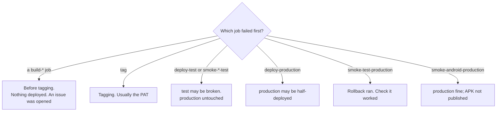

# Failed release

`release.yml` in mootmaker-release went red. How the pipeline works is in
[delivery](../overview/delivery.md#the-release-pipeline).

## First, where did it stop?

```bash
gh run list -R geoffweatherall/mootmaker-release -w release.yml --limit 3
gh run view <run-id> -R geoffweatherall/mootmaker-release              # which jobs failed
gh run view <run-id> -R geoffweatherall/mootmaker-release --log-failed | tail -100
```



What each outcome leaves behind:

| Failed in | `production` | `test` | Version number | Record |
|---|---|---|---|---|
| A build | Unchanged | Unchanged | Not used | An issue in mootmaker-release |
| `tag` | Unchanged | Unchanged | Possibly tagged in some repositories | `FAILED` prerelease or an issue |
| `deploy-test`, test smoke | Unchanged | Whatever the failed deploy left | Used | `FAILED` prerelease |
| `deploy-production` | Possibly partly deployed | New version | Used | `FAILED` prerelease |
| Production web smoke | Rolled back to the previous release | New version | Used | `FAILED` prerelease, saying it rolled back |
| Production Android smoke | New version (web smoke passed) | New version | Used | `FAILED` prerelease; no APK |

## By stage

### A build failed

Each `build-*` job runs that component's unit and acceptance tests in a fresh ephemeral environment. Once
one fails, the others stop with a **"Stopped early"** annotation; look for the one that did not say that.

- **A test failure** is a real failure in that component's `main`, or a flaky test. Do not just re-run:
  read the failure, and see [flaky test](flaky-test.md).
- **A deploy failure** inside the build (`terraform apply` errors) is usually an AWS limit, a missing IAM
  permission on the release role, or a resource left by an earlier run. See [deploy failed](deploy-failed.md).
- The build's ephemeral environment is torn down by the job even on failure. If it is not, the sweep
  removes it within 48 hours, or see [ephemeral environment problems](ephemeral-environment-problems.md).

### `tag` failed

The tag job uses `RELEASE_TAG_PAT`, the one long-lived token. A `401`, `403` or "Bad credentials" means it
has expired or lost access to a repository: see
[expired or lost credentials](expired-or-lost-credentials.md#release_tag_pat).

### `test` failed

`test` is left exactly as the failure left it, on purpose, so it can be examined. The next release's
deploy to `test` will fail the same way until it is fixed. Look at:

- the deploy log in the run, and the `/mootmaker/release-pipeline` log group (saved query
  "mootmaker/release - everything for one version");
- for a smoke failure, the `smoke-test-failure-context` artifact on the run (screenshots and traces,
  kept 14 days);
- the [site is down](site-is-down.md) checks, pointed at `test` (`ENV=test`, `SITE=https://www.test.mootmaker.com`).

Fix the cause in the component, merge, and release again.

### Production smoke failed and rolled back

`rollback-production` rebuilt and redeployed the previous successful release from its tag, and
`smoke-test-rollback` tested it. Check both passed. If the rollback's smoke also failed, `production` is
broken now: go to [site is down](site-is-down.md).

Rollback restores code, not data. If the failed version changed data (a migration, a new item shape),
that change is still there.

## Retrying

Fix the cause first, on `main`. Then:

```bash
gh workflow run release.yml -R geoffweatherall/mootmaker-release -f bump=patch
```

**Always `patch` for a retry**, whatever bump the failed run asked for. The failed run already used up its
version number, including any major or minor step, so repeating the bump would count it twice.

Before retrying, scan open issues for anything this release now depends on; see
[delivery](../overview/delivery.md#before-starting-a-release).

## Rolling back by hand

Only if the automatic rollback did not run or did not work. Redeploy the last good release's tag of each
component to `production`. This is a hand deploy to `production`: record it in an issue, and follow it with
a normal release.

From the workspace root:

```bash
PREV=$(gh release list -R geoffweatherall/mootmaker-release --exclude-pre-releases --limit 1 --json tagName --jq '.[0].tagName')
for c in mootmaker-api mootmaker-webapp mootmaker-demo-data; do
  git -C $c fetch --tags && git -C $c checkout "$PREV"
done
(cd mootmaker-api && ./deploy.sh production)
(cd mootmaker-webapp && ./deploy.sh production)
(cd mootmaker-demo-data && ./deploy.sh production)
# then return each checkout to main
```

API first: the web app's deploy reads the API's published settings, and checks the API serves the schema
it was built for.
