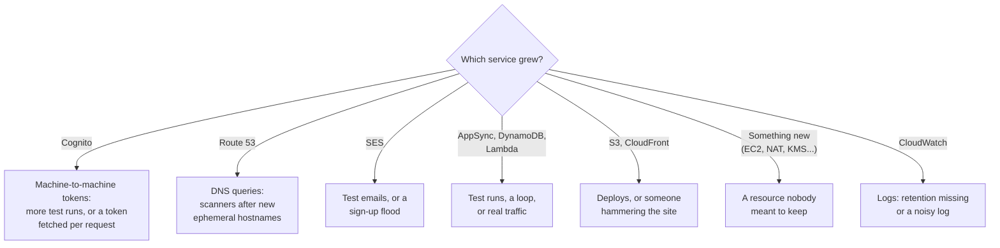

# Higher-than-expected bill

A budget email arrived (US$1 or US$10 a month, forecast or actual), or the bill looks higher than it
should. What normal looks like is in [cost and scale to zero](../overview/cost-and-scale-to-zero.md):
a few US dollars a month, almost all from releases and test runs.

Each Cost Explorer query costs US$0.01. Ask deliberately, not in a loop.

## 1. Which service, and when?

```bash
# By service, this month
aws ce get-cost-and-usage --region us-east-1 \
  --time-period Start=$(date +%Y-%m-01),End=$(date -d tomorrow +%F) \
  --granularity MONTHLY --metrics UnblendedCost --group-by Type=DIMENSION,Key=SERVICE

# By day, to see when it started
aws ce get-cost-and-usage --region us-east-1 \
  --time-period Start=$(date -d '14 days ago' +%F),End=$(date -d tomorrow +%F) \
  --granularity DAILY --metrics UnblendedCost
```



## 2. Was it activity?

Most of the bill is caused by work, so first ask what work happened:

```bash
gh run list -R geoffweatherall/mootmaker-release -w release.yml --limit 20     # releases, including failed ones
mootmaker-ephemeral-envs/list-ephemeral-envs.sh                                 # environments still up
```

A day of failed and retried releases can cost a dollar. That is the bill doing what the model says. If
releases explain it, stop there.

## 3. If activity does not explain it

| Service | Look at | Usual cause |
|---|---|---|
| Cognito | Cost Explorer usage type `CUPM2MTokenRequests`; count per day | A test suite or tool fetching a token per request rather than per run. Each token is US$0.00225 |
| Route 53 | `/aws/route53/mootmaker.com` (14 days of queries): which names are queried | Scanners querying hostnames from public certificate logs. Each ephemeral environment adds three names. See [cost-reduction.md](../../designs/cost-reduction.md) Measure 1 |
| SES | `aws sesv2 get-account --query SendQuota` | Many sign-ups (tests, or abuse); bounces |
| AppSync, Lambda, DynamoDB | Request counts in CloudWatch metrics; the resolvers log | A runaway loop (a client refetching constantly), a load test, or real traffic |
| Anything not in the system | `mootmaker-bootstrap-aws-accounts/list-unmanaged-resources.sh` | Something created by hand, or left by a half-finished destroy |
| CloudWatch | `mootmaker-bootstrap-aws-accounts/check-accumulation.sh` | A log group without retention, or a very chatty log |
| A service the system does not use | It should be impossible: the SCPs deny it | Treat as a [security incident](security-incident.md) |

## 4. Make it stop

- **A leftover environment**: tear it down. See [ephemeral environment problems](ephemeral-environment-problems.md).
- **A resource nobody claims**: delete it, after confirming what it is.
- **A runaway client or abuse**: find the source in the resolvers log. In an emergency, `production` can
  be taken down to nothing but the hosted zone by removing its components, but that ends the demo; prefer
  fixing the cause.
- **A code fault** (a token per request, a refetch loop): fix it, release, and add a test that would have
  caught it.

Raise an issue with the numbers either way, so the next look at the bill knows what this spike was.
