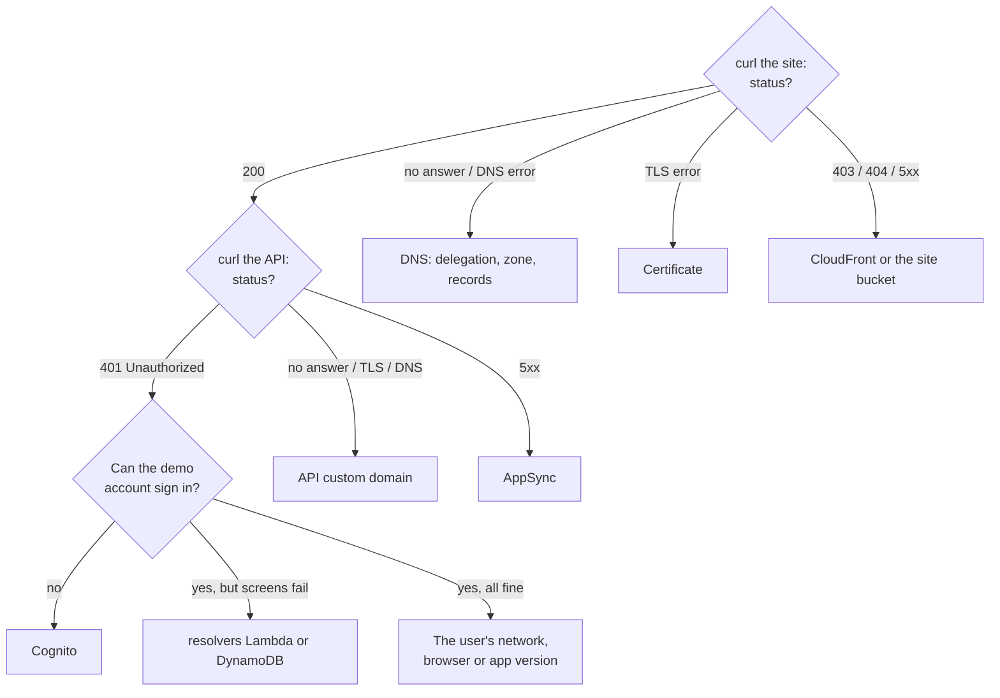

# Site is down

The web app does not load, or loads but every action fails, or the Android app says it cannot reach
Mootmaker. Work from the outside in.



## 1. The site

```bash
curl -s -o /dev/null -w '%{http_code}\n' https://www.mootmaker.com
curl -s https://www.mootmaker.com/env-config.js | head -5
```

Expect `200` and a `window.__MOOTMAKER_CONFIG__ = {...}` script.

| Result | Likely cause | Check and fix |
|---|---|---|
| Could not resolve host | DNS | `dig +short NS mootmaker.com` must list the Route 53 nameservers (`aws route53 get-hosted-zone --id <zone>`). If the registrar's delegation changed, fix it at Porkbun. `dig +short www.mootmaker.com` must return CloudFront addresses; if not, redeploy the web app (a release) to recreate the records |
| TLS or certificate error | Certificate expired or not attached | `echo \| openssl s_client -connect www.mootmaker.com:443 -servername www.mootmaker.com 2>/dev/null \| openssl x509 -noout -dates`. ACM renews automatically while its DNS validation record exists; if the record was deleted, a release recreates it |
| 403 from CloudFront | The site bucket is empty or the bucket policy is wrong | `aws s3 ls s3://$ENV-mootmaker-webapp-site-431071856068/` should list `index.html` and `assets/`. A release redeploys the files |
| 5xx from CloudFront | CloudFront or S3 incident | [AWS Health Dashboard](https://health.aws.amazon.com/health/status) |
| 200, but a blank page | A broken JavaScript build, or `env-config.js` missing | Browser console. `env-config.js` returning HTML instead of script means it was not uploaded; redeploy the web app |

`mootmaker.com` without `www` redirects to `www` through mootmaker-domain's CloudFront function. If only
the bare domain fails, look there.

## 2. The API

```bash
curl -s -w '\n%{http_code}\n' -X POST "$API" -H 'content-type: application/json' -d '{"query":"{__typename}"}'
```

Expect `401` with `UnauthorizedException`: AppSync is up and refusing an unauthenticated call.
Anything else (DNS, TLS, timeout, 5xx) points at the `api.` custom domain or AppSync itself; check the
same DNS and certificate steps for `api.mootmaker.com`, then the AWS Health Dashboard for AppSync.

## 3. Sign-in

Sign in with the demo login shown on the home page. If that fails for everyone, Cognito is the problem:

```bash
aws cognito-idp describe-user-pool --user-pool-id "$POOL" --query 'UserPool.{status:Status,name:Name}'
```

If the pool exists and is healthy, see [user cannot sign in](user-cannot-sign-in.md#the-demo-account).

## 4. After sign-in

The home page loads, but data does not appear or every action errors:

```bash
aws logs tail /aws/lambda/$ENV-mootmaker-resolvers --since 30m --filter-pattern ERROR
aws logs tail /aws/appsync/apis/$(aws appsync list-graphql-apis --query "graphqlApis[?name=='$ENV-mootmaker-api'].apiId" --output text) --since 30m
```

| In the logs | Means |
|---|---|
| `AccessDeniedException` from DynamoDB, S3 or Cognito | A permission is missing. Was there a hand change, or a deploy that failed half way? A release reapplies the Terraform |
| `ResourceNotFoundException` on a table | The table is gone. Check `aws dynamodb list-tables`; see [reset an environment](reset-an-environment.md) |
| `Task timed out after 15` | Something is very slow; see [app is slow](app-is-slow.md) |
| `Rate exceeded` / throttling | A Lambda concurrency or DynamoDB throttle; check for a runaway test or loop |
| Nothing at all | Requests are not reaching the Lambda: AppSync's log shows why |

## 5. Right after a release

If it broke straight after a release, the release's production smoke test should have failed and
rolled back. If it did not, roll back by hand by redeploying the previous release; see
[failed release](failed-release.md#rolling-back-by-hand).

## Afterwards

There is no monitoring that would have caught this
([mootmaker-release#92](https://github.com/geoffweatherall/mootmaker-release/issues/92)). Note in an
issue how it was noticed and how long it lasted.
