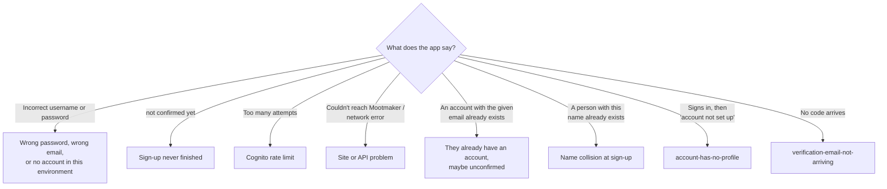

# User cannot sign in

A user cannot sign in, cannot finish signing up, or cannot reset their password. Background:
[identity and access](../overview/identity-and-access.md).

## Triage



First find the account. Cognito usernames are UUIDs; search by email:

```bash
aws cognito-idp list-users --user-pool-id "$POOL" --filter 'email = "someone@example.com"' \
  --query 'Users[].{user:Username,status:UserStatus,enabled:Enabled,created:UserCreateDate}'
```

`UserStatus` tells you most of what you need:

| Status | Meaning | Go to |
|---|---|---|
| (no user) | No account with that email in this environment | [No account](#no-account) |
| `UNCONFIRMED` | Signed up, never entered the code | [Unconfirmed](#unconfirmed) |
| `CONFIRMED` | A normal account | [Wrong password](#wrong-password-or-locked-out) |
| `RESET_REQUIRED` / `FORCE_CHANGE_PASSWORD` | An admin reset or created the password | [Admin password states](#admin-password-states) |
| `Enabled: false` | Disabled by an admin | Re-enable with `admin-enable-user`, if that was not deliberate |

## No account

- **Wrong environment.** Accounts belong to one environment's user pool. Someone who signed up on
  `www.test.mootmaker.com` has no account on `www.mootmaker.com`. On Android, the About screen shows
  which environment the app is using.
- **Deleted.** Deleting an account, or an admin deleting the person, removes the Cognito user. Outside
  `production`, `database-reset` also removes every account except the reserved ones.
- **Typo in the email.** Cognito answers "Incorrect username or password" for unknown emails on
  purpose, so the user cannot tell the difference. Ask them to check.

Fix: sign up again.

## Unconfirmed

The user signed up and never entered the code. Signing up again is refused because the email exists,
and a password reset is refused because the email was never verified.

**They can finish it themselves:** sign in with the same email and password. Both apps then ask for the
code, with **Send a new code** if the first one is lost (use case 150). If that email never arrives
either, see [verification email not arriving](verification-email-not-arriving.md).

If they have lost the password too, or cannot receive the email, an operator can do one of these:

```bash
# Confirm it for them. Only after confirming the email is genuinely theirs (they reply from it).
aws cognito-idp admin-confirm-sign-up --user-pool-id "$POOL" --username <Username>
```

Confirming fires the post-confirmation trigger, which creates their Person as for a normal sign-up.
Check it did: see [account has no profile](account-has-no-profile.md). Or:

```bash
# Delete it, so they can sign up again from the start.
aws cognito-idp admin-delete-user --user-pool-id "$POOL" --username <Username>
```

Deleting is the safer choice when you cannot verify who owns the email.

## Wrong password or locked out

- **Forgot password** works from the sign-in screen on both apps: they get a code by email and choose a
  new password. If no code arrives, see [verification email not arriving](verification-email-not-arriving.md).
- **"Too many attempts"** (`LimitExceededException` / `TooManyRequestsException`) is Cognito throttling
  repeated failures. It clears on its own after a while; there is nothing to reset.
- **The password policy** is at least 10 characters with a lowercase letter and a number. A new password
  that fails it is refused before it is sent.
- **As a last resort**, set a password for them. They should change it afterwards.

```bash
aws cognito-idp admin-set-user-password --user-pool-id "$POOL" --username <Username> \
  --password '<temporary password>' --no-permanent    # they must choose a new one at next sign-in
```

Neither app handles the "choose a new password" challenge that `--no-permanent` triggers. Use
`--permanent` instead, send them the password through a channel you trust, and ask them to change it
with Forgot password.

## Admin password states

`FORCE_CHANGE_PASSWORD` needs a "choose a new password" step neither app implements; both say "A
password change is required for this account." Set a permanent password as above. For
`RESET_REQUIRED`, ask the user to use Forgot password.

## Sign-up refused

| Message | Cause | What to do |
|---|---|---|
| An account with the given email already exists | They have an account, possibly unconfirmed | Look it up as above |
| A person with this name already exists | Another Person has that name, ignoring case and spaces. Names must be unique because people are picked by name | Choose a different name, for example with a middle initial |
| Password does not conform to policy | Fewer than 10 characters, or no lowercase letter or number | Choose another |

## The demo account

The demo login on the home page is `demo@mootmaker.com` with a random password generated at deploy
time. If it stops working:

- **The home page shows a password that fails.** The page and the pool disagree, which happens only if
  the web app was deployed against a different API deployment. Check the SSM value matches what the
  page shows, and redeploy the web app if not:

  ```bash
  aws ssm get-parameter --name /mootmaker/$ENV/api/demo-user/password --query Parameter.Value --output text
  curl -s "$SITE/env-config.js"
  ```

- **Someone changed its password or deleted it.** The demo account cannot delete itself, but anyone
  with AWS access could change it. A deleted demo user is recreated by the next release. A changed
  password is not (Terraform cannot read a Cognito password back), so set it to the SSM value:

  ```bash
  aws cognito-idp admin-set-user-password --user-pool-id "$POOL" --username demo@mootmaker.com --permanent \
    --password "$(aws ssm get-parameter --name /mootmaker/$ENV/api/demo-user/password --query Parameter.Value --output text)"
  ```

## When it is not one user

If nobody can sign in, it is not an account problem. See [site is down](site-is-down.md).
