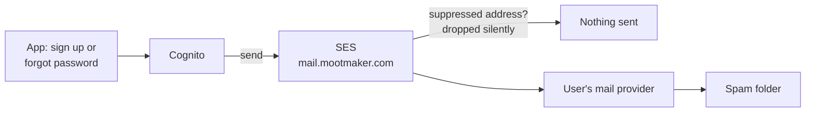

# Verification email not arriving

A user signs up or asks for a password reset, and no code arrives.

Codes are sent by Cognito through SES, from `noreply@mail.mootmaker.com`. SES has production access
(50,000 emails a day) and suppresses, account-wide, any address that has bounced or complained.



## Checks, in order

**1. Is it the right address, and did the action actually happen?** A typo in the email means the
code went somewhere else. For a reset, Cognito answers the same way whether or not an account exists,
so a reset for an address with no account "succeeds" and sends nothing. Look the account up as in
[user cannot sign in](user-cannot-sign-in.md#triage).

**2. Spam folder.** Ask the user to look, and to search for `mootmaker`.

**3. Is the address suppressed?** If an earlier email to it bounced (a full mailbox, a typo that
pointed at a real domain) or was marked as spam, SES drops every later email to it without error.

```bash
aws sesv2 get-suppressed-destination --email-address someone@example.com
# NotFoundException means it is not suppressed. If it is, and the address is now good:
aws sesv2 delete-suppressed-destination --email-address someone@example.com
```

**4. Is SES sending at all?**

```bash
aws sesv2 get-account --query '{sending:SendingEnabled,status:EnforcementStatus,sentLast24h:SendQuota.SentLast24Hours}'
```

`SendingEnabled: false` or an `EnforcementStatus` other than `HEALTHY` means AWS has paused sending,
usually for a high bounce or complaint rate. Read the reason in the SES console (Reputation metrics)
and, if needed, open a case with AWS. Every sign-up and reset in every environment is blocked until it
is resolved.

**5. Is the domain still verified?**

```bash
aws sesv2 get-email-identity --email-identity mail.mootmaker.com \
  --query '{verified:VerifiedForSendingStatus,dkim:DkimAttributes.Status}'
```

Both should be `true` / `SUCCESS`. If not, the DNS records from mootmaker-domain have been changed or
removed; redeploy mootmaker-domain.

**6. Is Cognito still pointed at SES?** The user pool's email configuration is set by mootmaker-api's
Terraform. If someone changed it to Cognito's built-in sender, a daily cap applies:

```bash
aws cognito-idp describe-user-pool --user-pool-id "$POOL" \
  --query 'UserPool.EmailConfiguration.{account:EmailSendingAccount,from:From}'
```

Expect `DEVELOPER` and `MootMaker <noreply@mail.mootmaker.com>`. A release puts it back.

## Mail to test addresses

Addresses under `@mail.mootmaker.com` (test accounts, fixture users) are never delivered to a mailbox.
SES receives them and puts them on the shared SQS queue that test suites read. If a test reports that
its code never arrived, see [flaky test](flaky-test.md#tests-that-read-real-email): the usual causes are
the receipt rule set no longer being active, or another run having already consumed the message.

```bash
aws ses describe-active-receipt-rule-set --query 'Metadata.Name'    # expect mootmaker-e2e-inbound
```

## Mail to `demo@mootmaker.com`

`mootmaker.com` itself has no MX record, so mail to the demo account bounces. If anyone uses Forgot
password on the demo login, the bounce counts against SES's reputation, and the address is suppressed
from then on. The demo account never needs email, so leave it suppressed.
